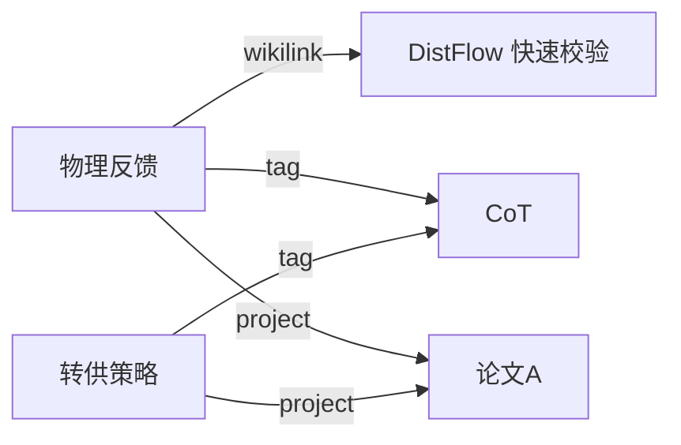
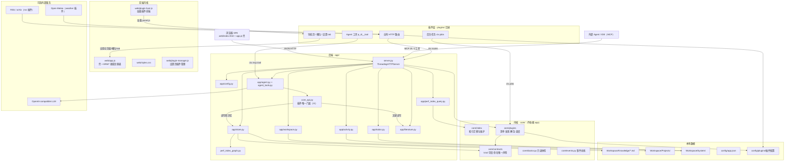
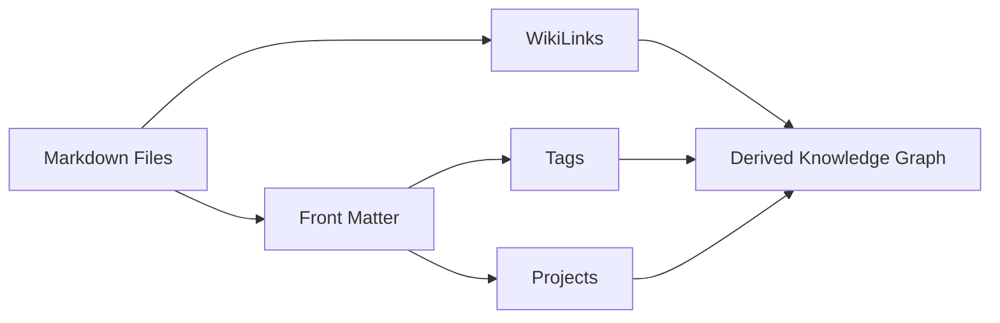
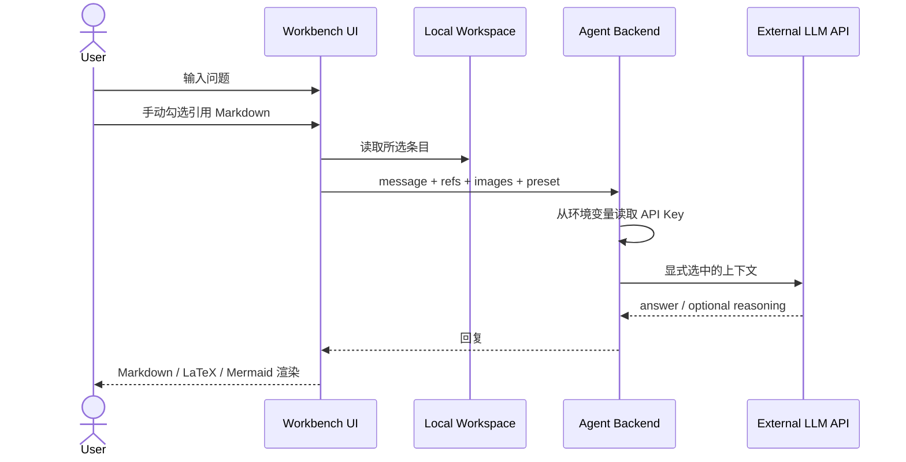

# Engineering Research Workbench

> 一个面向科研人员的本地优先、Markdown-first 工科科研工作台：项目管理、研究笔记、文献卡片、知识图谱、科研时间线、全文检索、RSS 资讯与可引用本地知识的 LLM Agent，统一在一个轻量 Web 界面中完成。

**当前版本：`v261022.9`**

**Windows 桌面版**：默认单文件便携版，将发布 ZIP 解压到可写目录后双击 `ResearchWorkbench.exe`；无需同级运行库目录，缺少同名 `.exe.config` 时会自动补建。支持右侧窗口控制、可配置关闭行为、托盘后台运行和重复启动唤回。最大化保留 Windows 任务栏。源码构建执行 `build_client.bat`，操作与数据位置见 [Windows 使用说明](docs/WINDOWS.md)。

> 📐 **项目结构与功能总览（含结构图）见 [`docs/OVERVIEW.md`](docs/OVERVIEW.md)**——三层结构、目录树、
> 数据流与插件生命周期图、12 个插件一览、内核功能清单、数据位置、闸门表、加功能决策表。
> 本文（README）偏使用与特性介绍。
>
> 📖 **使用教程见 [`docs/manual/`](docs/manual/README.md)**——**也可以直接在工作台里读**：
> 侧栏「系统 → 使用手册」（带截图的分章教程，内核自带、零插件也能读）。
>
> 🎨 **改界面之前先读 [`docs/UI_DESIGN.md`](docs/UI_DESIGN.md)**——视觉语言（色彩/字体/圆角/阴影）、
> 布局骨架、滚动规范、组件规格、主题与密度、插件 UI 接缝，以及改界面的验收清单。
>
> 🧩 **上游前端接了什么、没接什么**：[`docs/UPSTREAM_FRONTEND_INTEGRATION.md`](docs/UPSTREAM_FRONTEND_INTEGRATION.md)
> ——逐项列出接入点、接缝改造、未接入模块的理由与后续可选任务。
>
> 🚀 **要发布到 GitHub**：看 [`docs/PUBLISH.md`](docs/PUBLISH.md)（上线前检查清单、上传命令、
> 以及"清掉历史里的用户数据"的可回滚步骤）。

---

## ✨ 项目简介

Engineering Research Workbench 试图解决一个很具体的问题：

科研过程中，**想法、实验、文献、阶段总结、待办、项目文件、知识关系和 AI 对话往往分散在不同工具中**。当项目持续数月甚至数年后，真正困难的不是“记录一条笔记”，而是：

- 这条想法属于哪个项目？
- 它和哪些文献、实验、笔记有关？
- 某个研究主题过去几个月是如何演化的？
- 能否快速把一个知识节点的一阶 / 二阶关联整理成 Markdown？
- 能否让 LLM 只读取我明确选择的本地资料，而不是把整个知识库交给模型？
- 能否在不引入数据库锁定的前提下，把科研资产长期保留在普通文件系统里？

本项目因此采用：

> **Markdown 作为研究知识主数据，Workspace 作为文件系统主存储，图谱 / 搜索 / 热力图 / Agent 作为派生能力。**

即使未来不再使用本工作台，核心研究资料仍然可以直接使用 VS Code、Obsidian、Typora、Git 或任意文本工具读取。

---

## 🌟 核心特性

### 本地优先 / Markdown-first

- 灵感、研究日志、笔记、里程碑、工作总结、文献均保存为 Markdown。
- 元数据使用 YAML Front Matter。
- 图片落盘到 `Workspace/Knowledge/Attachments/`。
- 项目文件直接保存在普通目录中。
- 不依赖专有数据库才能读取研究内容。

### 科研仪表盘

概览页集中展示：

- 学业 / 博士阶段进度；
- 自定义毕业条件；
- GitHub contribution graph 风格科研热力图；
- 近 1–12 个月动态范围；
- 科研节奏与连续活跃统计；
- 当前待办；
- 近期里程碑；
- 项目推进；
- 最近灵感、笔记和总结；
- 快速记录入口。

科研热力图并非静态装饰，其数据来自本地活动日志，例如：

- Markdown 新建 / 更新；
- 待办创建 / 完成；
- 项目创建；
- 知识汇总；
- BibTeX 导出；
- Agent 对话等。

---

### 项目管理

项目不是一个抽象数据库对象，而是一个真实目录。

新建项目后会自动创建标准工程结构：

```text
Workspace/Projects/<ProjectName>/
├─ Notes/
├─ Experiments/
├─ Data/
├─ Results/
├─ Figures/
├─ Manuscript/
├─ References/
└─ README.md
```

在概览页的 **项目推进** 中可以直接点击 **＋ 新建项目**。

研究条目默认不强制绑定项目。需要关联时，通过项目选择器从已有项目中勾选：

- 默认项目为空；
- 不手动输入不存在的项目名；
- 一个条目可以同时关联多个项目；
- 可随时添加 / 移除关联。

---

### Markdown 研究笔记系统

编辑器支持：

- H1–H6；
- 粗体 / 斜体 / 删除线；
- 有序列表 / 无序列表 / Task List；
- 引用；
- GFM 表格；
- 链接；
- 图片；
- fenced code block；
- 代码高亮；
- 行内 LaTeX；
- 块级 LaTeX；
- Mermaid；
- `[[WikiLink]]`；
- 编辑 / 预览 / 分屏模式；
- 截图粘贴；
- 图片拖拽；
- `Ctrl + S` / `Cmd + S` 保存当前 Markdown。

示例：

```markdown
---
id: note-20260921-demo
kind: note
title: 论文标题
projects: ["论文A", "原型系统"]
tags: ["LLM", "Agent"]
status: 持续维护
---

# 物理反馈反馈

相关潮流方法见 [[DistFlow 快速校验]]。

$$
V_j^2 \approx V_i^2 - 2(r_{ij}P_{ij} + x_{ij}Q_{ij})
$$
```

Mermaid 示例：


---

### 文献管理与 BibTeX

“文献”模块使用 Markdown，而不是把文献卡片锁在单独数据库里。

每篇文献可以维护：

- 标题；
- 作者；
- 年份；
- 期刊 / 会议；
- DOI；
- URL；
- Cite Key；
- 标签；
- 项目；
- 阅读状态；
- 总结；
- 批注；
- BibTeX。

支持多篇文献批量导出 BibTeX：

```text
Workspace/Knowledge/Exports/BibTeX/
```

---

## 🧠 知识图谱

知识图谱由现有 Markdown 自动派生，不需要手动维护一份重复的图数据库。

### 节点类型

当前支持：

- 灵感；
- 研究日志；
- 笔记；
- 里程碑；
- 工作总结；
- 文献；
- 标签；
- 项目。

其中：

- Markdown 条目是实体节点；
- `tag:<name>` 是虚拟标签节点；
- `project:<name>` 是虚拟项目节点。

### 关系类型

图谱包含三类关系：

```text
[[WikiLink]]     → wikilink  / 显式引用
Markdown ↔ Tag   → tag       / 标签关联
Markdown ↔ 项目  → project   / 项目归属
```

例如：



### 图谱筛选

知识图谱页面可以分别控制：

**节点类别**

- 灵感
- 研究日志
- 笔记
- 里程碑
- 工作总结
- 文献
- 标签
- 项目

**关系来源**

- 显式引用
- 标签关联
- 项目归属

2D / 3D 图谱、邻域分析和 Markdown 导出都基于同一份 **filtered graph**：

> 当前图谱显示什么，导出就使用什么。

例如关闭“项目”节点后：

- 项目节点从图中消失；
- 项目边同步消失；
- 一阶 / 二阶邻域不再经过项目；
- 导出的关系索引也不再包含项目关系。

### 节点交互

点击节点后：

- 当前节点放大并加粗；
- 一阶相邻节点高亮；
- 直接相连的边加粗；
- 其它节点和边降低透明度。

点击画布空白处即可退出高亮状态。

### 关联 Markdown 汇总

选择任意文档、标签或项目节点后，可以：

1. 选择一阶 / 二阶邻域；
2. 自动发现当前可见图中的关联 Markdown；
3. 手动勾选 / 取消；
4. 生成总 Markdown；
5. 复制到剪贴板；
6. 保存到：

```text
Workspace/Knowledge/Exports/KnowledgeBundles/
```

非常适合：

- 写论文某一节；
- 做阶段汇报；
- 整理某个标签主题；
- 汇总某个项目资料；
- 为 Agent 构造局部上下文。

---

## 🕒 里程碑与 3D 时间线

里程碑既是 Markdown，又可以切换为时间轴或 3D 时间线。

3D 视图支持：

- 自动缓慢旋转；
- 左键拖动画板；
- `Alt + 拖动` / 右键拖动旋转视角；
- 滚轮缩放；
- 一键复位；
- 暂停 / 恢复自动旋转；
- 点击卡片返回对应里程碑 Markdown。

---

## 🤖 科研 Agent

Agent 通过本地持久化任务运行器，把外部 LLM、研究资料、Skill 和长期记忆连接起来。

原 Agent 页面直接提供 **对话 / 任务 / 记忆 / 技能 / RAG / 设置**。主页面和悬浮助手共享当前会话、实时回答及草稿状态，可在任一处确认草稿后继续任务；流中断会按任务编号恢复结果，不重复提交。技能在“技能”页按项启用，RAG / 记忆 / Skill 三个独立总开关位于输入框下方，与发送按钮同一行；聊天区的模型选项默认折叠。“设置 → RAG / 嵌入模型”、Agent 的 RAG 页或输入框旁的齿轮可配置 Embedding 接口、测试连接、增量构建向量索引和试用检索。支持关键词、语义和混合检索，默认关键词模式不消耗嵌入额度。AI 回复选区提供“引用”和“问 AI”，在当前 Agent 对话继续追问。数据层参考 [CortexDB](https://github.com/liliang-cn/cortexdb) 的 scoped memory、来源关系和 ContextPack 设计，用 Python + SQLite 实现。使用说明、依赖、数据迁移和能力边界见 [Agent 系统文档](docs/AGENT_SYSTEM.md)。

### Agent 能做什么

- 多轮对话；
- 会话历史；
- 文本输入；
- 图片选择；
- 图片拖拽；
- 截图粘贴；
- Markdown / LaTeX / Mermaid 回复渲染；
- 手动引用研究资料；
- OpenAI-compatible Chat Completions；
- 原生工具调用及文本协议回退；
- 标准 `SKILL.md` 发现、显式激活与资源按需加载；
- 带来源的长期记忆、中文全文检索与关系扩展；
- 后台任务检查点、断线继续、审批后续跑；
- 按页读取 PDF、Crossref 文献检索与公开网页读取；
- 可选的 Docker 隔离 Python 执行与 Streamable HTTP MCP；
- 每轮动态选择请求模式；
- 显示模型请求等待状态与耗时；
- 可选显示兼容接口返回的 reasoning 内容。

### 已接入的模型服务

设置 → Agent / LLM 的「Agent API 配置」可保存多套 OpenAI-compatible 配置（只存本机 `config/secret.json`，已被 `.gitignore` 排除）：

| 配置 | Base URL | 默认模型 |
| --- | --- | --- |
| Qianwen3.8-Flash | `https://maas.qianwenaiapi.com/compatible-mode/v1` | `qwen3.8-flash` |
| OpenCode Go · 本地代理 | `http://127.0.0.1:9355/zen/go/v1` | `deepseek-v4.1-flash` |
| OpenCode Go · 直连 Zen | `https://opencode.ai/zen/go/v1` | `deepseek-v4.1-flash` |
| 火山方舟 · Agent Plan | `https://ark.cn-beijing.volces.com/api/plan/v3` | `deepseek-v4.1-flash` |
| OpenCode 免费档 · 本地 CLI 桥 | `http://127.0.0.1:9357/v1` | `deepseek-v4.1-flash-free` |

每套配置可带多个请求模式（模型 / 思考开关 / 温度 / 附加参数），在对话框里逐轮切换；切换整套配置用 Agent 页顶部的「API 配置」下拉，或在设置页中「设为当前配置」。两套 OpenCode Go 分别是「走本机反代理」与「直连 `opencode.ai`」；直连一套靠配置里的**自定义请求头**满足上游的 `x-opencode-session` 要求（设置页「Agent API 配置」里可直接编辑 JSON）。

**免费档要经本机 CLI**：`deepseek-v4.1-flash-free` 只在 Zen 通用网关（`/zen/v1`），且上游按「请求里的 opencode 工具集」识别客户端，非 OpenCode 客户端直连一律 `403 FreeTierError`。所以工作台不直连，而是把请求交给本机官方 CLI：

```bash
python tools/opencode_cli_bridge.py          # 起本地桥：127.0.0.1:9357
```

桥把 OpenAI Chat Completions 请求摊平成一段文本交给 `opencode run --format json`，再把 `text` 事件与 token 用量包回工作台。代价与边界：只做纯文本问答（拿不到原生 function calling，工具循环退化为普通回答）；CLI 侧工具全部拒权（`config/opencode-cli-bridge.json`），并跑在独立临时目录；免费档限速很紧，偶发 429 会原样显示。

### 手动引用本地知识

Agent 不会默认把整个 Workspace 发给模型。

点击：

```text
＋ 引用研究 · 知识
```

可以搜索并勾选：

- 灵感；
- 研究日志；
- 笔记；
- 里程碑；
- 工作总结；
- 文献。

本轮会先加入：

1. 当前用户消息；
2. 当前附加图片；
3. 用户本轮明确选择的 Markdown；

作为额外上下文发送给配置的 LLM 服务。启用相应工具的人设还可以主动检索、读取研究资料，并自动召回当前作用域中的长期记忆；调用轨迹和来源可在 Agent 系统中查看。

这使 Agent 更接近：

> **可控上下文科研助手**

而不是“自动上传整个知识库”。

---

## 🔐 API Key 与环境变量

工作台不保存真实 API Key。

设置页只保存：

```text
API Key 环境变量名称
```

默认：

```text
OPENAI_API_KEY
```

运行模型调用时，Python 进程从操作系统环境变量中读取真实值。

### 方式一（推荐）：本地私密文件 config/secrets.json

该文件已被 `.gitignore` 排除，不会上传 git。在 `env` 对象中填入 `"环境变量名": "密钥值"`：

```json
{
  "env": {
    "OPENAI_API_KEY": "你的密钥"
  }
}
```

服务运行中保存后自动注入环境变量（按文件修改时间热重载，无需重启），`run.bat` 启动无需每次手动设置 Key。若设置页填写的是其它变量名（如 `DASHSCOPE_API_KEY`），在 `env` 中添加对应条目即可。

> `config/secrets.json` 只存在于本机；工作台不会把 Key 回写到 `config/app.json`、Workspace 或任何接口返回中。

### 方式二：临时环境变量（仅当前会话有效）

### Windows PowerShell

```powershell
$env:OPENAI_API_KEY="your-api-key"
python server.py
```

例如使用其它变量名：

```powershell
$env:DASHSCOPE_API_KEY="your-api-key"
python server.py
```

然后在：

```text
设置 → Agent / LLM → API Key 环境变量名称
```

填写：

```text
DASHSCOPE_API_KEY
```

### Linux / macOS

```bash
export OPENAI_API_KEY="your-api-key"
python3 server.py
```

> API Key 不会被写回 `config/app.json`、Workspace 或 Agent 会话文件。

---

## ⚙️ Agent 请求模式

不同 OpenAI-compatible 服务对“思考模式”的参数定义并不统一。

因此工作台没有把具体供应商参数写死，而是使用 JSON 请求预设。

默认提供：

```json
[
  {
    "id": "default",
    "label": "默认（不附加参数）",
    "params": {}
  },
  {
    "id": "qwen-low",
    "label": "Qwen · 低思考",
    "params": {
      "enable_thinking": true,
      "thinking_budget": 1024
    }
  },
  {
    "id": "qwen-off",
    "label": "Qwen · 无思考",
    "params": {
      "enable_thinking": false
    }
  }
]
```

可以自行配置：

```json
{
  "reasoning_effort": "high"
}
```

或者供应商支持的其它参数。

前端会自动把预设生成成对话框中的下拉选项，每一轮可以动态切换。

为避免错误覆盖关键数据，以下核心字段不会被请求预设覆盖：

- `model`
- `messages`
- `input`
- `instructions`
- `stream`

---

## 💬 Agent 对话体验

用户提问靠右、AI 回答靠左。生成时，发送按钮切换为“停止”；主界面和悬浮助手均可中断当前任务，已生成内容会保存到会话，刷新后仍可查看。

历史提问的“编辑重发”会将修订后的问题追加为新消息，保留原提问和原回答，并可点击“查看原提问”返回原记录。取消编辑会恢复输入框原先未发送的草稿。

回复中的 `[[条目标题]]` 和 `[[条目ID|显示名称]]` 可直接打开对应知识条目；文献配有 PDF 时进入阅读工作区，不受当前文献列表分页或筛选影响。关键词检索优先匹配准确标题，再按相关性排序；多个检索词分别匹配，项目名称匹配的权重较低。`kb_read` 支持准确标题，并返回可继续读取的来源 ID。

Agent 回归验证使用临时工作区、模拟模型及本地 HTTP 接口，不调用付费模型：后端运行 `python -m unittest discover -s tools -p 'test_*.py'`，界面运行 `node tools/agent_system_ui_check.js`（需要 Playwright 和 Edge）。

发送消息后采用乐观渲染：

```text
用户按 Enter
    ↓
用户消息立即进入对话区
    ↓
输入框立即清空
    ↓
显示“模型正在思考 / 生成回复”
    ↓
显示请求耗时
    ↓
模型回复
```

如果兼容接口返回：

- `reasoning_content`
- `reasoning`
- `thinking`
- `analysis`

工作台可以将其显示为可折叠的：

```text
模型思考过程
```

是否显示可以在 Agent 设置中控制。

如果接口不返回 reasoning，则不会人为生成虚假的思考过程。

---

## 🔎 全局搜索

快捷键：

```text
Ctrl + K
Cmd + K
```

统一搜索：

- Markdown 标题；
- 正文；
- 标签；
- 项目；
- 文献作者；
- DOI；
- Cite Key；
- Todo；
- Agent 会话标题；
- Agent 历史消息。

搜索结果可以直接跳转到对应条目。

---

## 📰 科研资讯

> 🔌 **本功能现在是插件**（`plugins/rss`）：内核不带资讯代码，停用插件后侧栏不出现「资讯」页。
> 下面描述的行为不变——插件后端仍走 `/api/plugins/rss/*`，配置落在 `config/plugins/rss.json`。

资讯模块支持 RSS / Atom。

默认可配置 arXiv 等科研信息源。

针对 arXiv，后端提供多级回退：

```text
rss.arxiv.org RSS
        ↓ 失败
arXiv Atom API
        ↓ 失败
兼容 HTTP 回退
```

同时：

- 单源短重试；
- 每个源显示抓取状态；
- 显示错误诊断；
- 强制刷新真正重新请求；
- 网络失败时不会用空结果覆盖已有有效缓存；
- 若旧缓存存在，则继续展示旧内容并标记 stale。

因此网络故障不会影响本地 Markdown、图谱和项目管理。

---

## 🌤️ 天气

> 🔌 **本功能现在是插件**（`plugins/weather`，顶栏槽位 + 设置模态）：配置落在 `config/plugins/weather.json`，
> 内核只提供「顶栏槽位」这个挂载点，不认识天气。

天气使用 Open-Meteo。

特点：

- 无需 API Key；
- 可配置地点、经纬度和时区；
- 天气请求故障不影响核心本地功能。

---

## ⏱️ 专注计时

> 🔌 **本功能现在是插件**（`plugins/focus`，自登记侧栏页面）：停用后侧栏不出现「专注」，设置存浏览器本地。

支持：

- 自定义专注时长：1–240 分钟；
- 自定义休息时长：1–120 分钟；
- 25 / 45 / 60 / 90 分钟快速预设；
- 本地保存设置；
- 环形进度显示。

---

# 🏗️ 系统架构

项目采用轻量的 Browser SPA + Python 标准库 HTTP Server 架构。


    AGENT --> SYS

    CFG --> APPJSON
    CFG --> RSSJSON

    AGENT -->|Explicit user-selected context| LLM
    RSS --> ARXIV
    WEATHER --> METEO
```

---

## 前端

核心文件：

```text
web/
├─ index.html
├─ app.js
└─ styles.css
```

职责包括：

- 单页路由；
- 侧边栏；
- 仪表盘；
- Markdown 编辑器；
- 2D / 3D 图谱；
- 3D 时间线；
- Agent UI；
- 搜索；
- 设置中心；
- 页面动画；
- 热力图。

---

## 后端

后端基于 Python 标准库 `ThreadingHTTPServer`。

```text
server.py
└─ app/
   ├─ config.py
   ├─ workspace.py
   ├─ store.py
   ├─ activity.py
   ├─ todos.py
   ├─ perf_index_query.py
   ├─ agent.py
   ├─ rss.py
   └─ weather.py
```

### `app/config.py`

负责：

- 应用配置；
- RSS 配置；
- Agent 配置；
- 环境变量 Key 状态；
- Reload。

### `app/workspace.py`

负责：

- Workspace 初始化；
- 项目目录创建；
- 项目文件树；
- 路径边界；
- 旧数据迁移。

### `app/store.py`

核心研究数据层：

- Markdown CRUD；
- Front Matter；
- 图片附件；
- 文献 / BibTeX；
- 项目；
- 标签；
- WikiLink；
- 知识图谱；
- 邻域；
- Knowledge Bundle；
- Dashboard 聚合。

### `app/activity.py`

append-only 科研活动日志：

```text
Workspace/System/activity.jsonl
```

用于：

- 科研热力图；
- 本月活跃；
- 连续活跃；
- 科研节奏。

### `app/perf_index_query.py`

统一搜索：

```text
Markdown + Todo + Agent History
```

### `app/agent.py`

负责：

- Agent 会话；
- 图片附件；
- 手动知识引用；
- 请求预设；
- OpenAI-compatible 调用；
- Responses API；
- reasoning 提取；
- 环境变量 API Key。

### `plugins/rss/backend.py`（原 `app/rss.py`）

> 已搬成插件（v261009 起）：内核里不再有 `app/rss.py`；下面这些职责现在由插件承担。

负责：

- RSS；
- Atom；
- arXiv fallback；
- 缓存；
- 错误诊断。

### `plugins/weather/backend.py`（原 `app/weather.py`）

> 同样已搬成插件：内核只提供「顶栏槽位」挂载点，不认识天气。

负责 Open-Meteo 天气。

---

# 📁 Workspace 设计

首次启动后会创建：

```text
Workspace/
├─ Knowledge/
│  ├─ Ideas/
│  ├─ Journals/
│  ├─ Notes/
│  ├─ Milestones/
│  ├─ Summaries/
│  ├─ Literature/
│  ├─ Attachments/
│  └─ Exports/
│     ├─ KnowledgeBundles/
│     └─ BibTeX/
│
├─ Projects/
│  └─ <ProjectName>/
│     ├─ Notes/
│     ├─ Experiments/
│     ├─ Data/
│     ├─ Results/
│     ├─ Figures/
│     ├─ Manuscript/
│     ├─ References/
│     └─ README.md
│
├─ Resources/
│
└─ System/
   ├─ Cache/
   ├─ Trash/
   ├─ AgentChats/
   │  ├─ Attachments/
   │  └─ Trash/
   ├─ todos.json
   └─ activity.jsonl
```

---

# 🗃️ Markdown 数据模型

典型 Markdown：

```yaml
---
id: note-20260921-abcd
kind: note
title: CoT
created: "2026-09-21T09:00:00"
updated: "2026-09-21T10:30:00"
status: 持续维护

project: 论文A
projects:
  - 论文A
  - 原型系统

tags:
  - LLM
  - Agent

pinned: false
---
```

正文：

```markdown
# 快速反馈

快速反馈模块使用 [[DistFlow 快速校验]]。

下一步需要验证 [[物理反馈状态]] 的稳定性。
```

其中：

- `project`：兼容旧数据的第一主项目；
- `projects`：完整多项目列表；
- `tags`：知识主题；
- `[[WikiLink]]`：显式知识关系。

---

# 🔄 核心数据流

## Markdown → Knowledge Graph



图谱不是独立主数据库，因此不会产生：

> Markdown 改了，但图数据库没同步

这样的双主数据问题。

---

## Local Knowledge → Agent



---

# 🚀 快速开始

## 1. Clone

```bash
git clone https://github.com/Smooling/engineering-research-workbench.git
cd engineering-research-workbench
```

## 2. 启动

### Windows

```powershell
python server.py
```

或：

```powershell
.\run.bat
```

### Linux / macOS

```bash
python3 server.py
```

如果使用脚本：

```bash
chmod +x run.sh
./run.sh
```

打开：

```text
http://127.0.0.1:8765
```

---

# ⚙️ 配置

主要配置文件：

```text
config/
├─ app.json
└─ rss.json
```

### `config/app.json`

包含：

- 工作台名称；
- 端口；
- Workspace 路径；
- 学业进度；
- 天气；
- UI；
- Agent / LLM；
- 请求预设。

### `config/rss.json`

包含：

- RSS / Atom 地址；
- 是否启用；
- 每个源最大条数。

---

# 🔌 主要 HTTP API

以下为主要接口示例，并非完整 API 文档：

| Endpoint                        | 用途              |
| ------------------------------- | ----------------- |
| `GET /api/health`             | 健康检查          |
| `GET /api/config`             | 获取脱敏配置      |
| `POST /api/config/app`        | 保存应用配置      |
| `GET /api/docs`               | 查询 Markdown     |
| `POST /api/docs`              | 创建 Markdown     |
| `GET /api/graph`              | 生成知识图谱      |
| `POST /api/graph/bundle`      | 生成关联 Markdown |
| `GET /api/search?q=`          | 全局搜索          |
| `GET /api/projects`           | 项目列表          |
| `POST /api/workspace/project` | 创建项目          |
| `GET /api/agent/sessions`     | Agent 会话列表    |
| `POST /api/agent/send`        | 发送 Agent 消息   |
| `GET /api/rss`                | 科研资讯          |
| `GET /api/weather`            | 天气              |

---

# 🧪 自检

项目提供自检：

```bash
python tools/self_check.py
```

覆盖内容包括：

- Workspace 自动创建；
- Markdown CRUD；
- 全文搜索；
- 多项目；
- 标签；
- WikiLink；
- 知识图谱；
- 一阶 / 二阶关联；
- 图谱筛选导出；
- BibTeX；
- 图片；
- Todo；
- Agent 会话；
- 图文请求；
- 请求预设；
- reasoning；
- 环境变量 API Key；
- 科研热力图；
- RSS / arXiv fallback；
- Python 语法；
- JavaScript 语法。

---

# 🔒 隐私与安全说明

本项目以本地使用为主要场景，但仍需注意：

### 默认保留在本地

- Markdown；
- 项目文件；
- Todo；
- Agent 历史记录；
- 科研活动日志；
- 图片附件；
- 知识图谱派生关系。

### 会离开本机的内容

仅在使用外部服务时：

**LLM**

- 当前问题；
- 当前附加图片；
- 本轮手动选择的 Markdown 上下文。

**RSS / 天气**

- HTTP 请求本身。

如果研究数据涉及：

- 未公开论文；
- 企业项目；
- 保密实验；
- 未公开数据集；

请根据所使用 LLM 服务商的隐私和数据保留政策决定是否发送。

---

# 🧩 设计原则

### 1. Markdown is the source of truth

研究知识不依赖数据库才能读取。

### 2. Local-first

外部 LLM、天气、RSS 全部属于可选增强能力。

### 3. Explicit over implicit

图谱关系优先来自：

- WikiLink；
- 标签；
- 项目。

不会默认让 LLM 自动生成不可追踪的知识关系。

### 4. Human-in-the-loop

关联 Markdown 和 Agent 上下文最终由用户勾选。

### 5. Derived views are disposable

图谱、热力图和搜索索引可以重新生成，原始 Markdown 不受影响。

### 6. Failure isolation

RSS、天气或外部模型不可用时，不应影响 Markdown 和 Workspace 主流程。

---

# 📌 当前适用场景

这个工作台尤其适合：

- 博士 / 硕士长期科研项目；
- 多篇论文并行推进；
- 工科实验记录；
- 算法方案迭代；
- 文献精读；
- 科研项目管理；
- Markdown 知识库；
- 使用 LLM 辅助科研但希望控制本地上下文的用户。

---

# ⚠️ 当前边界

本项目当前定位是：

> **单用户、本地优先科研工作台。**

目前不重点解决：

- 多用户权限系统；
- 云端协同编辑；
- 企业级身份认证；
- 大规模数据库集群；
- 自动语义向量数据库；
- 自动将整个知识库上传给 LLM。

知识图谱当前主要是显式关系图，而不是自动 embedding / semantic graph。

---

# 🧩 插件体系

工作台按 **内核 / 插件 / 数据** 三层组织，判据只有一条：**「零插件可跑」**（去掉 `plugins/` 全部内容，
知识库读写、检索、图谱数据、文献梳理、Agent 对话与设置页都必须照常工作）。

| 层 | 位置 | 职责 | 硬约束 |
| --- | --- | --- | --- |
| **内核** | `core/` + `app/` + `web/app.js` | 契约、索引、知识库、文献梳理、Agent 基础、界面壳、插件运行时 | 内核**不认识任何具体插件**（`grep` 不到插件名） |
| **插件** | `plugins/<id>/` | 具体功能：页面、槽位、设置 tab、HTTP 路由、Agent 工具、后台任务、自己的存储与配置 | 只许 `from core_api import …`；不得改内核 DOM/CSS、不得直写 `Workspace/` |
| **数据** | `Workspace/` + `config/` | Markdown + frontmatter 是**唯一事实来源**；SQLite 索引只是可重建的派生物 | 插件数据落自己的命名空间（`Workspace/Plugins/<id>` 等） |

**插件能做什么（都用自登记，内核不需要改）**：侧栏导航页 / 顶栏或浮层槽位 / 设置页 tab / 阅读区 tab、
自有 HTTP 路由（`/api/plugins/<id>/*`）、给 Agent 加工具（`p_<id>__<tool>`，写工具自动走草稿确认闸门）、
后台定时任务（`ctx.jobs`）、订阅内核事件（`ctx.events`）、产出文件下载（`ctx.raw`）、
读知识库（`core_api.entries/entry/projects/todos/…`）、写条目正文（`core_api.entry_update` + 写工具闸门）。

**当前 12 个插件**（详细目录与每个插件的说明见 [`plugins/README.md`](plugins/README.md)；
想自己写一个见 [`plugins/.template/`](plugins/.template/) 与 [`docs/PLUGIN_SPEC.md`](docs/PLUGIN_SPEC.md)）：

| 插件 | 提供什么 | 默认 |
| --- | --- | --- |
| `literature-reader` | 文献阅读工作区：PDF 阅读 + 批注 + 笔记 tab + 阅读区 AI（2 个 Agent 工具） | 附属（开） |
| `knowledge-graph` | 知识图谱页与总览迷你图（整页接管） | 附属（开） |
| `floating-assist` | 悬浮球 AI 助手：对话 / 引用 / 截图问图 / 人设 tab / 工具轨迹（`overlay` 槽位） | 附属（开） |
| `billing` | 用量计费：订阅 `llm.usage` 事件逐条记账 | 附属（开） |
| `focus` | 专注计时（纯前端页面，设置存浏览器本地） | 附属（开） |
| `rss` | 科研资讯：RSS/Atom 聚合 + arXiv 多级回退 | 附属（开） |
| `weather` | 天气：顶栏槽位 + 逐日预报 + 离线降级 | 附属（开） |
| `version-manager` | 版本族：查看 / 逐节合并 / 归档取回（3 个 Agent 工具，写走草稿闸门） | 附属（开） |
| `report-export` | 报告导出：DOCX（标准库写 OOXML）/ HTML（可打印成 PDF）/ Markdown | 可选（关） |
| `backup-snapshot` | 备份与快照：内核后台任务定时打包知识库与配置、按份数清理 | 可选（关） |
| `milestone-calendar` | 日历：里程碑/待办到期视图 + 顶栏常驻角标 | 可选（关） |
| `metrics-table` | 指标表：读条目正文表格与 ```metrics 块，跨实验对照 + CSV/Markdown 导出 | 可选（关） |

**安装 / 启停 / 预览**：把目录或 `<id>-<version>.zip` 丢进 `plugins/` 即被发现（zip 会自动解包到
`plugins/<id>/`，旧版本整体进回收站）；在**设置 → 插件**里启停、看权限/路由/工具/依赖、编辑插件配置，
**鼠标移到插件卡片上就能看到演示预览**（摘要 + 功能点 + 界面截图，由插件自己在 `plugin.json` 的
`preview` 里声明）。后端改动需**重启**，只改插件前端刷新即可。

---

# 🛠️ 开发目录

```text
.
├─ app/                    # 后端：知识库读写 / 索引 / 文献 / Agent / 项目 / 待办
│  ├─ store.py             #   条目读写 + 关系解析 + 命名同步（971 行）
│  ├─ perf_index_*.py      #   SQLite 派生索引（db/core/query/graph/runtime）
│  ├─ agent.py             #   对话循环 + 草稿确认流（924 行）
│  ├─ agent_tools.py       #   工具执行入口（内核 4 个 kb_* + 插件工具）
│  ├─ literature.py        #   文献库：条目/PDF/批注/笔记/BibTeX
│  ├─ config.py            #   config/app.json 读写、密钥解析
│  ├─ projects.py / todos.py / activity.py / search.py / workspace.py
│  └─ indexer.py           #   索引门面（from core.plugins import … 时也用它）
│
├─ core/                   # 内核层：**不依赖 app/mcp**（plugin_check 会拦）
│  ├─ contracts/           #   kind / 字段 / 命名 / 骨架的唯一声明处
│  ├─ index/               #   索引迁移（migrations/）与维护
│  ├─ plugins/             #   插件运行时：manifest·registry·loader·context·unpack·jobs
│  ├─ doctor.py            #   只读体检（error/warn 清单）
│  ├─ events.py            #   进程内事件总线（插件可订阅 llm.usage 等）
│  └─ net.py               #   出网兜底（系统代理指向回环且没监听时自动直连）
│
├─ core_api.py             # 插件**唯一**允许 import 的门面（I3）
│
├─ plugins/                # 插件库（11 个；放进来即被发现）
│  ├─ .template/           #   模板：照它改就不用动内核（tools/new_plugin.py 会自动改名）
│  ├─ literature-reader/   #   附属：PDF 阅读 + 批注 + 笔记 tab + 阅读区 AI
│  ├─ knowledge-graph/     #   附属：图谱页与总览迷你图（整页接管）
│  ├─ floating-assist/     #   附属：悬浮球 AI 助手（overlay 槽位）
│  ├─ billing/ focus/ rss/ weather/   # 附属：计费 / 专注 / 资讯 / 天气
│  └─ report-export/ backup-snapshot/ milestone-calendar/ metrics-table/  # 可选
│
├─ web/                    # 前端（无构建步骤，server.py 直接提供）
│  ├─ app.js               #   壳 + ERW* 接缝注册表（1379 行）
│  ├─ plugin-host.js       #   加载已启用插件的前端脚本
│  ├─ plugin-manager.js    #   设置页「插件」：启停 / 详情 / **演示预览**
│  ├─ manifest.json        #   装配清单（index.html 的三段引用由它生成）
│  ├─ styles.css + v2609*.{js,css}   # 版式与逐项补丁
│  └─ vendor/              #   重型库本地副本（pdfjs / mermaid / mathjax / marked / hljs…）
│
├─ mcp/                    # MCP 工具服务（25 个工具：kb_* / ws_* / todo_* / 导出）
├─ tools/                  # 运维与闸门脚本（见下）
├─ docs/                   # 架构与规范：SCOPE / PLUGIN_SPEC / REFACTOR_PLAN / ARCHITECTURE…
├─ config/                 # app.json（内核设置）· secrets.json · plugins/<id>.json（插件配置）
├─ Workspace/              # 用户数据（gitignore + Syncthing 同步）
├─ build/ ResearchWorkbench.exe      # 打包产物（PyInstaller）
├─ .scratch/               # 临时数据：仅本地、不入库、7 天自动清理
├─ .rag/ + rag/            # 早期 RAG 实验的源码与索引（92 MB，保留待复用）
├─ CHANGELOG.md · VERSION · README.md · AGENTS.md
└─ server.py · client.py · run.bat · run.sh
```

**闸门脚本（改完必须跑的）**：

| 脚本 | 管什么 |
| --- | --- |
| `tools/kb_smoke.py` | 知识库读写冒烟（条目/字段/命名/回收站） |
| `tools/web_check.py` | 前端静态：语法、装配清单一致、`window.ERW*` 接缝提供/消费、加载顺序 |
| `tools/ui_smoke.py` | 真浏览器走查：每条路由可渲染、0 console error、首屏不拉重型库 |
| `tools/plugin_check.py` | 插件隔离：内核不得 import 插件、`core/` 不得 import `app`、零插件可跑 |
| `python -m core.doctor` | 只读体检（数据/索引/契约漂移；error 0 才算健康） |
| `python -m core.plugins list\|check\|verify` | 插件发现 / 单插件校验 / 全库盘点（`--install` 顺带解包） |
| `python tools/new_plugin.py <id>` | 从 `plugins/.template/` 生成新插件（先临时后原子、安装期同一套校验） |
| `python tools/doc_check.py` | 文档里的 **mermaid 图能否渲染**（用仓库自带 mermaid 真浏览器验证；`--export` 顺带导出 SVG） |
| `python -m mcp.server --selftest` | MCP 工具表自检 |

### 知识库结构（七类条目 + 关系层）

知识库按 **七类** kind 分目录落盘（`Workspace/Knowledge/<KindDir>/<id>.md`，扁平存放，不建子目录）：

| kind | 目录 | 前缀 | 说明 |
| --- | --- | --- | --- |
| `idea` `journal` `note` `milestone` `summary` `literature` | `Knowledge/{Ideas,Journals,Notes,Milestones,Summaries,Literature}` | 详见 `kb_constraints` | 原有六类 |
| `experiment` | `Knowledge/Experiments` | `实验-` | **v261008.2 新增**：一次实验一条，独立状态机（计划 / 进行中 / 完成 / 受阻 / 已归档）与实验专用骨架；原先混在 `note` 里的「实验」类别词已废弃 |

**关系层**：正文「关联」小节的小标题决定关系类型，索引据此生成**类型化边**（无需新增 frontmatter 字段）：

| 「关联」段小标题 | 关系类型 | 回答什么问题 |
| --- | --- | --- |
| `### 依据的知识` | `uses-knowledge` | 这个实验/结论用了哪些知识 |
| `### 用到的数据` | `uses-data` | 用到了哪些数据集与产物 |
| `### 引用文献` | `cites` | 依据或对照了哪些文献 |
| `### 同系列实验` | `series` | 哪些实验属于同一系列 |
| `### 上一环节` / `### 下一环节` | `chain-prev` / `chain-next` | 实验链条的前后顺序 |
| `### 产出与汇总` | `produces` | 归集到哪张总结 / 里程碑 |

历史条目的行内写法（如 `- 方法条目：[[知识-方法-…]]`）同样会被识别成对应类型，**存量条目无需改写**；未命中的链接记为通用 `wikilink`。跨项目通用的基础知识：`projects` 留空 + 标签 `通用基础`，列表页选「未归属项目（通用基础）」即可集中阅读，其在各项目的使用情况仍可从图谱看到。

生成与迁移工具：

- `tools/kb_tree.py` → 知识树 / 交叉使用清单 / 实验依赖视图 / 通用基础清单，输出到 `Workspace/Knowledge/Exports/KnowledgeTree/`；
- `tools/kb_migrate_experiments.py` → `知识-实验-…`（旧）迁移为 `实验-…`（`--dry-run` 预览 / `--apply` 执行，幂等）；
- `tools/kb_smoke.py` → 结构与关系层冒烟测试（只读：关系解析、命名规则、归属归一化、关系边、七类条目、工具与约束渲染、迁移幂等）；
- 完整底层口径（数据库与接口变更、迁移记录、已知陷阱）见 [docs/KNOWLEDGE_RELATIONS.md](docs/KNOWLEDGE_RELATIONS.md)。

### 操作临时数据 `.scratch/`

`server.py` 启动时会初始化 `.scratch/` 作为专属的本地操作临时空间，并按保留期清理过期文件：

- **不入库**：`.gitignore` 白名单模式下显式声明 `/.scratch/`；`_verify_*` / `_preview_*` / `_timing_*` 三类临时产物在任意目录都不入库。
- **不入同步**：Syncthing 只同步 `Workspace/`（该目录下有 `.stfolder`），`.scratch/` 不会被带到其他机器。
- **自动清理**：默认保留 7 天（按文件 mtime 判定），骨架目录与 `.scratch/README.md` 永不删除；可用环境变量 `ERW_SCRATCH_RETENTION_DAYS` 覆盖保留期。
- **一键清理**：双击 `tools\scratch_clean.bat`；`python tools/scratch_clean.py --dry-run` 预览，`--status` 查看占用。
- 目录约定（`tmp/ verify/ preview/ logs/`）与注意事项见 `.scratch/README.md`。

---

# 🗺️ Roadmap

一些适合后续继续扩展的方向：

- [ ] 标签自动补全 / 标签管理；
- [ ] 引用关系类型细分；
- [ ] 可选语义关联推荐；
- [ ] 用户确认后再写入 AI 推荐关系；
- [ ] 项目级 Agent Context；
- [ ] 实验数据索引；
- [ ] Git Commit / 文件修改与科研热力图联动；
- [ ] Markdown 模板系统；
- [ ] 文献 DOI / BibTeX 自动补全；
- [ ] Agent 流式输出；
- [ ] 更完整的 OpenAI-compatible provider presets；
- [ ] 数据备份 / 导入 / 导出；
- [x] Windows 桌面封装与托盘后台运行；
- [ ] PWA。

---

# 🤝 Contributing

欢迎通过 Issue / Pull Request 提交：

- Bug；
- UI 改进；
- Markdown 编辑能力；
- 知识图谱增强；
- OpenAI-compatible Provider 适配；
- RSS / 文献源；
- 科研工作流建议。

提交代码前建议运行：

```bash
python tools/self_check.py
```

---

## Acknowledgements

本项目受到本地优先知识管理、Markdown 笔记系统、知识图谱、科研工作流与现代 LLM Agent UI 的启发。

核心目标始终是：

> **让科研资料保持可读、可迁移、可追踪，同时让 AI 成为研究工作流中的可控增强层，而不是新的数据孤岛。**
