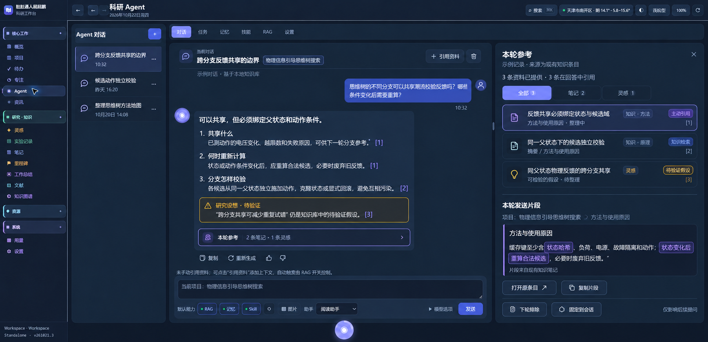

# Agent「本轮参考」开发设计

日期：2026-10-22  
对照版本：v261022.1 当前工作区  
状态：第一阶段已实现，源码待发布；见 [实现与验证说明](AGENT_CONTEXT_SOURCES_IMPLEMENTATION.md)  
关联文档：[Agent 系统](AGENT_SYSTEM.md)、[Agent 升级设计](AGENT_UPGRADE_DESIGN.md)

## 1. 目标与范围

为每条 Agent 回答提供「本轮参考」入口。用户可查看本轮实际提供给模型的知识、选区和记忆，预览当时的内容片段，并打开对应的知识条目。回答中的来源引用与右侧面板联动。

这是现有 Agent 的来源记录及展示能力扩展。沿用已有检索、知识库、工具调用、任务检查点和持久化机制，不增加用于推断来源的模型调用。

### 1.1 第一阶段必须交付

- 统一展示手动引用、当前页面/选区、RAG 结果、知识读取工具和记忆。
- 保存并展示实际提供片段；区分检索命中、请求提供与回答明确引用。
- 来源绑定到具体回答，支持历史回看和刷新恢复。
- 同条目合并展示，多片段、多次读取和内容版本保留明细。
- 回答入口、侧面板、来源筛选、片段预览、复制和原条目跳转。
- 旧记录缺少精确信息时明确标记，不补造快照或调用过程。

### 1.2 后续阶段

- 「下轮不自动引用」「固定到当前会话」。
- 更精细的小节/段落定位，以及历史片段与最新版对照。
- 网页、普通文件、PDF 等更多来源适配器。

### 1.3 范围约束

- 「已提供」描述请求上下文，不表示模型在推理中一定使用过。
- 「已引用」仅表示回答中存在已解析的明确来源引用，不自动评判引用是否支持结论。
- Skill 指令、系统规则和工具定义不计入知识条目数；继续使用现有技能及能力展示。
- 不新增知识管理系统，不重建 RAG，不改变现有写入审批流程。

## 2. 实际知识库示例与 UI



图中对话、请求状态及统计为交互示意，并非实际执行记录。来源条目和选中片段取自当前知识库。

项目：**物理信息引导思维树搜索的大模型负荷转供方法**。

示例问题：

> 思维树的不同分支可以共享潮流校验反馈吗？哪些条件变化后需要重算？

| 编号 | 现有条目 | 示例用途 |
| --- | --- | --- |
| 1 | [知识-方法-反馈共享必须绑定状态与候选域](../Workspace/Knowledge/Notes/note-a1f33a471d196d1ccc.md) | 说明共享反馈的状态和动作条件 |
| 2 | [知识-原理-同一父状态下的候选独立校验](../Workspace/Knowledge/Notes/note-ab654fcaf07e102df1.md) | 说明候选应独立施加动作并克隆或回滚状态 |
| 3 | [灵感-同父状态物理反馈的跨分支共享](../Workspace/Knowledge/Ideas/idea-eddea39447cc462cb5.md) | 展示相关研究设想，保留待验证标记 |

选中第 1 条时，片段预览展示其「方法与使用原因」原文：

> 缓存键至少含状态哈希、负荷、电源、故障隔离和动作；状态变化后重算合法候选，必要时废弃旧反馈。

这些知识笔记属于现有知识库的整理内容；界面不能将其自动升级为已独立核实的论文结论。「待验证假设」读取明确标签或元数据；不能因为类型为「灵感」就推断所有灵感都属于待验证假设。

## 3. 交互设计

### 3.1 回答入口

在回答正文下方、复制等操作附近展示：

```text
本轮参考  2 条笔记 · 1 条灵感  ›
```

- 默认收起，不自动挤占对话空间。
- 点击后打开该回答的来源面板；再次点击或点击关闭按钮收起。
- 没有资料时显示「本轮未提供知识资料」，不推断回答无依据或未参考聊天历史。
- 记录不完整时显示「来源记录不完整」，不以 0 条代替未知。
- 来源入口始终绑定回答 ID；同一个任务的旧回答、暂停回答和继续后的回答分别展示自己的记录。

### 3.2 右侧面板

保留当前深蓝底色、紫色主色、分组导航、会话列表、Agent 功能标签和输入区。

面板从上到下：

1. 回答标题或提问摘要、关闭按钮。
2. 有明确口径的统计，例如「本轮提供 3 个来源 · 回答明确引用 2 个」。
3. 全部、笔记、灵感、记忆等类型筛选；没有某类时不显示空标签。
4. 来源卡片：标题、类型、进入方式、明确引用状态及可用位置。
5. 当前来源的片段列表及选中片段正文。
6. 打开原条目、复制片段；后续阶段再增加固定与排除。

一张来源卡片可同时显示「主动引用」「知识检索」「工具读取」。详情按请求顺序列出片段，不用进入方式重复创建来源卡片。

宽屏采用可调整宽度的右侧面板，并保存面板宽度；初始建议约 480px。应保留可用的对话最小宽度，空间不足时改用覆盖式抽屉，不强行压缩成多列。悬浮助手使用共享组件的数据和交互，在其宽度下采用抽屉或全幅详情。

### 3.3 导航与状态

- 点击回答引用：打开该回答面板并选中对应来源。
- 点击另一条回答入口：切换来源，保留各回答最近选中项。
- 打开原条目：复用现有统一导航和历史返回；有可靠锚点时定位小节或片段。
- 锚点失效：仍打开条目并提示「内容已变化，未能定位原片段」。
- 切换会话：关闭旧面板或加载新会话对应记录，禁止残留旧来源。
- 流式更新只更新变化区域；不重置片段滚动、文本选区和面板宽度。
- 键盘可操作；打开后焦点可进入面板，Escape 关闭并返回原入口。

## 4. 统计与状态口径

### 4.1 三种事实

| 概念 | 判定依据 | 不得混用 |
| --- | --- | --- |
| 检索命中 | 工具确实返回的结果，按调用保留 | 不是全库潜在匹配数，也不是最终引用数 |
| 本轮已提供 | 来源片段进入本轮至少一次已发起的模型请求 | 不表示最后一次请求仍保留全文，也不证明模型采用 |
| 回答明确引用 | 最终回答中的引用解析到本轮来源 | 不表示自动核实了结论支持性 |

请求失败或中断必须保留请求状态。对于是否实际发出也无法确认的异常，标记未知，不能标为已确认送达；产品文字不承诺供应商已处理内容。

示例：`kb_search` 返回 12 条，完整结果进入模型请求，回答引用其中 3 条，应显示「提供 12 个来源、明确引用 3 个」。只有实际进行过候选筛选，才允许展示「命中 12、提供 3」。没有记录的统计项不显示。

### 4.2 去重与粒度

- 顶部数量按来源实体去重，知识以稳定 doc_id、记忆以 memory_id 为基础；来源类型参与命名空间。
- 同一来源出现多个版本，列表仍算一个来源，但详情必须保留各版本。
- 同一版本的不同片段分别保存；完全相同内容及位置可复用快照。
- 多次搜索、工具重试、任务继续不直接累加成多个来源。
- 文献卡片与它的 PDF 可作为一个实体的不同表示，详情标明笔记/题录/PDF 及实际读取范围。
- 检索次数与来源数量分别计算；展示跨调用命中并集时明确写「去重来源」。

### 4.3 多次请求及上下文压缩

记录每次请求包含的内容表示：`full`（该内容块完整保留）、`partial`（截短）、`extractive`（仅保留摘录）、`omitted`（本次移除）。`full` 不等于全文，只表示原内容块未被再次裁剪。

默认列表是本轮提供来源的并集。可展开查看「第 2 次请求提供；后续压缩为节选」等状态。最终回答对应的生成请求单独标记，以便区分「本轮曾提供」与「生成这条回答时仍提供」。

## 5. 后端方案

### 5.1 带来源的内容块

建议新增 `app/agent_sources.py`，统一处理来源采集、快照、请求清单及面板投影。以下均为拟新增设计。

上下文在内部以结构化块携带来源，序列化后仍使用现有模型消息协议，不向供应商增加自定义字段：

```json
{
  "block_id": "blk_example",
  "source_id": "knowledge:note-a1f33a471d196d1ccc",
  "origin": "tool_read",
  "entity_version": "<当时版本>",
  "locator": {
    "heading_path": ["方法与使用原因"],
    "offset": 0,
    "end_offset": 0
  },
  "text": "<本块实际内容>",
  "complete": true
}
```

上例 offset 数值仅为字段示意；实际未知时省略或为 null，不能填 0 伪装精确位置。统一采用正文的 Unicode 字符索引，由后端生成，前端不要按 JavaScript UTF-16 索引自行解释。标题路径和定位范围也只能保存真实获取的信息。

每个片段同时保存显示标题、类型、项目、标签、来源版本、原始内容哈希、进入方式及可用定位信息。来源正文与 Skill 指令、系统规则分开处理。

### 5.2 采集入口

| 来源 | 现有入口 | 需要补充 |
| --- | --- | --- |
| 手动引用 | `agent._reference_context()` | 返回实际保留片段与来源映射，记录单篇及总体预算截断 |
| 当前页面/选区 | `agent._page_context()` | 保留具体条目、选区及页面内容边界，不只拼接为字符串 |
| 自动记忆 | `agent_memory.recall()` | 对实际进入 context_pack 的文本保存快照及截断信息 |
| RAG | `kb_search`、`agent_rag.search()` | 保留搜索调用、来源实体和各命中片段映射 |
| 知识读取 | `kb_read` 等工具结果 | 通过适配器提取实际返回正文和位置 |
| 历史带入 | `agent_context.history_messages()` | 保留已有来源映射，区分本轮新加入与历史带入 |

原始工具结果是「获得了哪些内容」的记录；真正提供清单必须以随后发起的模型请求为准。适配器仅处理有明确来源契约的工具，不根据任意工具描述猜测来源。

### 5.3 在最终请求组装处确认内容

现有 `execute_loop()` 会过滤能力、插入 Skill、压缩上下文，再转换文本工具协议，最后调用 `_post_chat()`。

新增逻辑顺序：

```text
来源内容采集与快照
    → 组装带来源映射的消息
    → 现有能力/作用域过滤
    → 预算裁剪及历史压缩，同时更新映射
    → 原生工具协议或文本回退协议序列化
    → 持久化本次请求清单（prepared）
    → 发起模型请求，更新请求状态
    → 保存生成片段及对应请求
    → 完成回答来源视图与引用关联
```

来源元数据在内部传递，不能作为额外字段直接提交给模型接口。优先裁剪结构化内容再序列化，避免从被截断的工具 JSON 中事后猜测来源。压缩若生成混合历史摘录，必须携带保留下来的原内容范围及来源映射；不能把参与生成摘录的所有来源一律算作仍完整提供。

不能仅在回答完成后扫描 `evidence` 或搜索原文来宣称「准确发送片段」。无法精确映射的旧代码路径应返回 unknown/incomplete，随后逐个适配。

### 5.4 请求、任务与回答分别关联

- run_id 表示一个可暂停/继续的任务；一次任务中可以出现多个公开回答。
- request_id 表示一次具体模型请求；文本协议回退、网络重试分配独立 attempt，不覆盖旧记录。
- message_id 表示用户看到的一条回答。
- 回答保存生成它的 request_id，以及当时纳入本轮统计的请求集合。
- 回答含多段公开生成内容时，分别关联对应请求，入口默认展示这些片段的来源并集。
- 暂停、取消或等待审批形成的回答视图应冻结；后续继续任务不能反向修改旧回答的统计。
- 同一回答自身流式进行时可递增更新，结束后转为冻结版本。
- 准备、发送、收到响应、失败、取消/未知等请求状态单独保存，不能把 prepared 当作已提供。

### 5.5 存储建议

继续使用 `Workspace/System/Agent/brain.sqlite`，以有版本、可重复执行的迁移增加下列表。字段为设计建议，编码时可精简，但关系与不变量应保留。

| 表 | 关键内容 |
| --- | --- |
| `source_snapshots` | snapshot_id、来源实体、版本、当时标题/类型/标签、位置、精确文本、内容哈希、创建时间 |
| `run_sources` | run_id、source_id、实体定位、首次获得时间；用于来源聚合 |
| `context_requests` | request_id、run_id、step、attempt、状态、协议、时间、上下文完整性 |
| `request_source_blocks` | request_id、block_id、source_id、输入/实际发送快照引用、表示状态、进入方式、原调用及顺序 |
| `message_source_views` | message_id、run_id、所含 request_ids、最终生成请求、引用映射、摘要、revision、完整性 |

来源实体被删除不应级联删除旧快照。任务/会话的清理则沿用已有回收和恢复语义，关联记录一并处理。无引用快照可在明确的清理流程中回收。

快照按实体、版本、位置和精确内容哈希复用。会话列表及普通消息只返回摘要，正文按需读取。不要把完整请求、系统提示词、认证头或密钥作为来源快照保存。

若快照达到存储限制或写入失败，应标记记录不完整，并保留可恢复信息；不能截短后仍标为完整。来源记录失败不应导致重复执行工具或重复写入知识库。

## 6. 接口与实时更新

以下接口均为拟新增，必须与现有路径分发顺序协调，避免被通用 sessions/runs 路由提前截获。

| 方法与路径 | 用途 |
| --- | --- |
| `GET /api/agent/sessions/{sid}/messages/{mid}/sources` | 返回该回答的摘要、来源卡片和片段元信息 |
| `GET /api/agent/sessions/{sid}/messages/{mid}/sources/{source_id}?snapshot_id=...` | 按需读取该回答可见的具体快照 |
| `GET /api/agent/runs/{rid}/sources` | 获取进行中任务的临时来源视图，用于刷新及断线恢复 |

最终消息新增轻量摘要，例如：

```json
{
  "source_summary": {
    "schema_version": 1,
    "revision": 8,
    "recording_status": "complete",
    "provided_source_count": 3,
    "cited_source_count": 3,
    "counts_by_kind": {"note": 2, "idea": 1}
  }
}
```

上述数字仅对应示例。接口中的内部定位标识不直接呈现在 UI。

SSE 新增 `sources_updated`：携带 run_id、可用的 message_id、revision 和摘要。前端对较旧 revision 忽略，对重复事件幂等处理。只在面板已打开时拉取相应清单，不随 token 增量反复请求。

完成事件携带最终摘要。来源写入应先于对应事件持久化，断线后通过既有事件游标和查询接口恢复。来源 GET 是纯读取，不能顺带执行检索或调用模型。

每次快照查询必须验证 snapshot_id 属于指定回答/任务；任意文件路径不能成为读取参数。Markdown 展示沿用已有清洗规则。

## 7. 引用解析与来源定位

第一阶段沿用 `[[实际标题]]` 及现有条目链接。以 Markdown 解析结果中的明确链接建立引用映射，不把代码块、示例文本里的类似语法算作引用。

1. 优先按稳定实体标识关联。
2. 标题及别名在本轮来源集合内唯一时可关联到对应实体。
3. 同名无法消歧时标记未关联，不随意选择第一条。
4. 链接指向未提供来源时允许保留导航，但不计入「本轮来源已引用」。
5. 引用解析到实体，只能证明实体级引用；没有明确片段定位时，不强行宣称支撑某个具体段落。

数字 `[1]`、`[2]` 可作为前端表现层编号，实际关系保存在结构化映射中。不会因为模型自行输出了一个数字就产生有效引用。

来源定位先检查当前版本：版本相同则使用可靠锚点或正文范围；变化后尝试标题路径及原片段匹配，失败则打开条目并提示，不移动到猜测位置。

## 8. 前端实现边界

建议新增共享组件 `web/agent-sources.js` 和 `web/agent-sources.css`。主 Agent 页、悬浮助手及任务结果页复用数据和操作，不各自实现一套来源解析。

| 现有文件 | 预计改动 |
| --- | --- |
| `web/agent-client.js` | 接收摘要/SSE、管理当前回答与来源选择、请求缓存和过期响应隔离 |
| `web/app.js` | 主回答来源入口、布局挂载、与现有导航联动 |
| `web/v260930-floating-agent.js` | 复用入口/面板；替换或整合原 RAG 依据展示 |
| `web/agent-system.js` | 任务结果与对话使用相同来源组件 |
| `web/index.html` | 加载新增组件和样式 |

主客户端状态最少包含 session_id、message_id/run_id、selected_source_id、snapshot_id、revision 和面板尺寸。异步返回必须校验当前选择；切换会话后到达的旧请求不得覆盖新面板。

不要让数字引用、标题链接和来源卡片分别维护不一致的解析规则。原有工具轨迹仍保留；来源面板承担资料查阅，不堆叠原始 JSON 和诊断信息。

## 9. 历史兼容、投影与备份

- 新消息优先使用结构化来源记录。
- 旧消息可从 `evidence`、`retrievals`、用户当时保存的 context_text 等恢复有证据的内容。
- 旧工具返回值只能证明工具获得过内容，不能证明压缩后的实际请求包含全文。按「历史工具返回片段，发送范围未记录」展示。
- 无法还原的手动引用/记忆不从当前最新版拼造历史快照。
- 导航仍可打开现有条目，但与历史快照明确区分。
- 延续现有会话 JSON 投影与同步机制：导出包含来源摘要及其可移植快照集合，或采用同一投影内的去重快照包；不能只导出本机数据库 ID。
- 导入对消息、来源快照及回答视图幂等处理，缺少快照时显示可解释的降级状态。
- 在线 SQLite 备份应覆盖新表；不改变已有禁止直接同步运行中 SQLite/WAL 的要求。
- 忘记记忆控制后续召回；已有回答中的历史记录如何保留须在界面说明，不能以「忘记」误导为已删除所有历史内容。

## 10. 固定与排除的后续设计

「下轮不自动引用」写入会话级偏好，影响下一轮新增的自动检索、自动记忆及固定注入。只在上下文组装前执行过滤才算生效。它不承诺移除历史回答中已经出现的信息。

被排除资料被用户再次主动选择时，先在引用栏明确提示，由用户移除排除或取消引用，避免出现隐式优先级。

「固定到当前会话」保存来源实体标识及选定范围；下一轮读取最新版，为每轮保存各自快照。固定项在输入区可见且可移除。范围无法定位、来源删除、能力或作用域不允许时，显示原因。固定不绕过仅 RAG 模式、权限及上下文预算，也不把旧快照悄悄当作当前最新版。

这部分不纳入第一阶段验收，示意图按钮可在第一阶段隐藏，避免出现无效入口。

## 11. 开发拆分

| 阶段 | 工作项 | 交付门槛 |
| --- | --- | --- |
| A：准确采集 | 来源模型、快照迁移、手动引用/记忆/搜索/读取适配、压缩映射、请求及回答关联 | 可用脚本化模型逐次验证实际请求与记录一致 |
| B：完整查阅 | 只读接口、回答入口、共享面板、引用联动、响应式与无障碍 | 主页面、悬浮助手、刷新和断线恢复行为一致 |
| C：兼容收尾 | 旧消息降级、JSON 投影/导入、备份、存储边界 | 旧记录可解释，新记录可迁移，原 Agent 回归通过 |
| D：会话偏好 | 下轮不自动引用、固定资料与冲突提示 | 过滤和预算处理由后端实际执行，界面与行为一致 |

建议后端集中在新增 `agent_sources.py`，现有 `agent.py`、`agent_context.py`、`agent_runtime.py`、`agent_memory.py` 和 `agent_tools.py` 增加必要的来源映射与调用；RAG 主算法保持原有职责。

## 12. 验收与测试

### 12.1 自动化测试

使用一次性 Workspace、脚本化模型及本地模拟接口，不需要付费模型请求。必须检查真正提交的模型 messages，与保存的发送片段逐一比较。

| 场景 | 验收要求 |
| --- | --- |
| 手动引用被单篇或总体预算截短 | 快照与实际发送内容相同，截断标记准确 |
| 搜索返回 12 条且全部发送，回答只引用 3 条 | 提供数为 12、引用数为 3；不伪造中间筛选 |
| 搜索后读取同一条目 | 卡片去重，检索与读取片段及请求关系分别保留 |
| 多轮压缩、历史摘录与能力过滤 | full/partial/extractive/omitted 和对应快照准确 |
| 自动记忆最后一条被截短 | 不以完整记忆正文替代实际发送片段 |
| 同条目在任务过程中发生修改 | 各版本快照保留，聚合卡片不丢明细 |
| 暂停/审批后继续、请求回退或重试 | 请求身份不冲突，不修改已冻结旧回答，计数不膨胀 |
| 回答中同名、无效或代码内伪引用 | 不错误关联，不增加有效引用数 |
| 来源修改、改名或删除 | 历史片段可读，当前导航给出正确结果或明确提示 |
| 服务重启、SSE 断线和重复事件 | 可从持久化恢复，面板幂等更新，无重复工具执行 |
| 快速切换会话、回答、来源 | 旧异步返回不覆盖当前选择，滚动不被增量更新打断 |
| 旧消息、JSON 导出/导入及数据库备份 | 不伪造历史内容，新快照可随记录恢复 |
| 无来源、记录不完整和快照读取失败 | 文案区分无资料与未知，提供可重试错误态 |
| 越权快照标识及恶意 Markdown | 不读取其他记录或任意文件，沿用安全清洗 |

新增测试建议使用 `tools/test_agent_sources.py` 与 `tools/agent_sources_ui_check.js`；并按实际改动范围运行现有 Agent 系统、RAG 和 UI 回归。

### 12.2 人工验收样例

以第 2 节的现有知识材料构造确定性记录，确认：

1. 回答入口显示 2 条笔记、1 条灵感，引用映射与卡片对应。
2. 第 1 条的原文片段逐字一致，复制结果一致。
3. 第 3 条保留知识库明确的「待验证假设」标记，回答不把预期收益表述成已测结果。
4. 点击引用选择正确卡片；打开原条目和返回对话保持可用。
5. 当前深蓝紫色宽屏界面不改变既有导航；收起面板后恢复对话宽度。
6. 较窄窗口采用抽屉，键盘可打开、选择和关闭。

验收应比较系统实际输出及保存记录；设计图中的示例数字不能替代执行证据。
