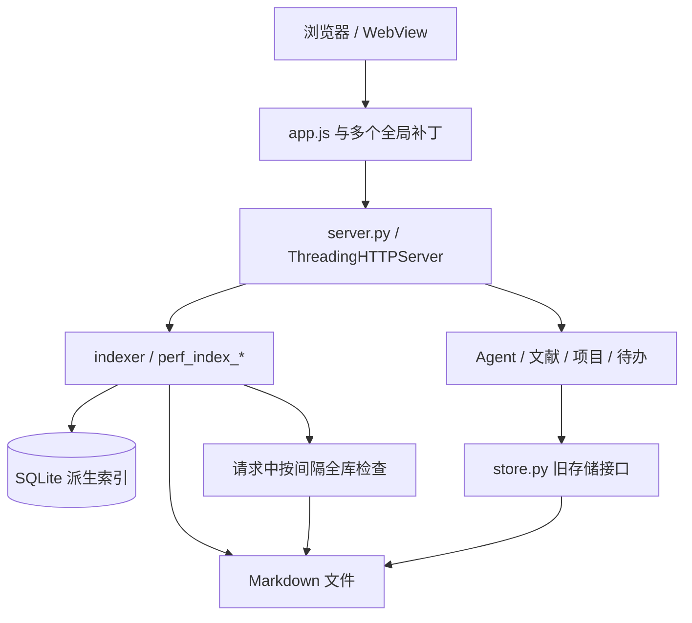
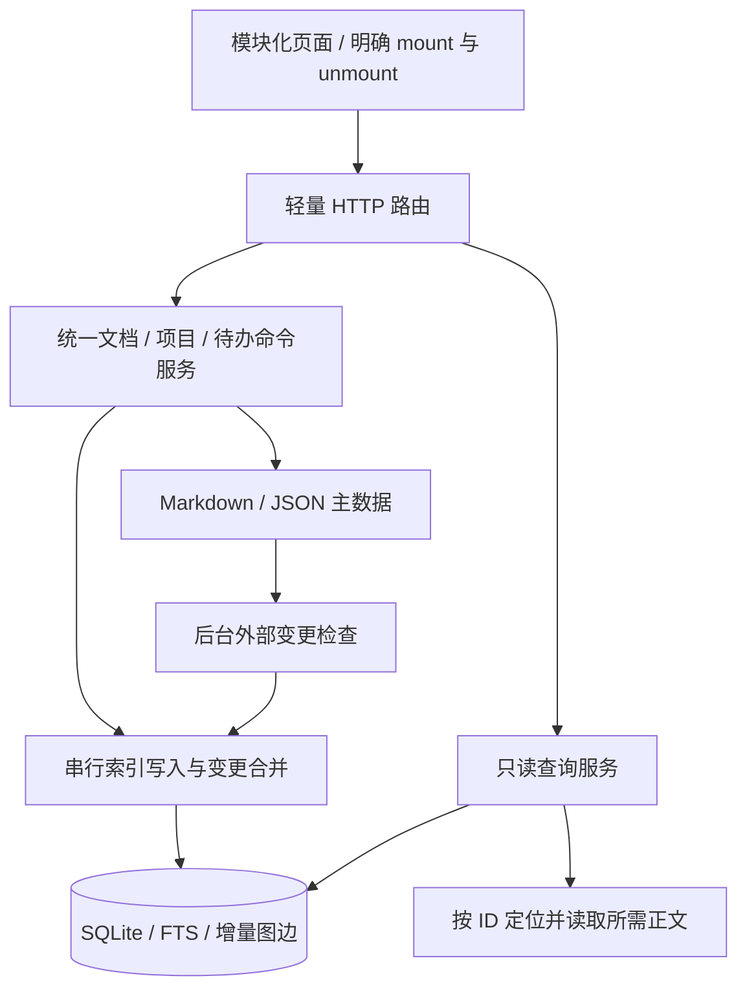

# 架构与性能审查 · 2026-10-15

本文保留优化前的审查基线，代码位置及旧脚本对应下述提交。后续已实施的优化和对比结果见 [性能架构文档](PERFORMANCE_ARCHITECTURE.md)；当前复测使用 `tools/performance_benchmark.py --synthetic 10000`。

审查基线：`feature/ui-redesign-v2` / `cbb4dcf`。审查覆盖 HTTP 路由、Markdown 存储、SQLite 索引、Agent 工具、文献管理、图谱、前端入口及验证脚本。本次未修改业务代码、用户配置或研究资料；运行数据使用 `.scratch/architecture-audit-20261015/generated-data/` 中的合成工作区。

## 判断

现有的「本地单体应用 + Markdown 主数据 + 可重建 SQLite 索引」适合这个产品。分页、FTS5、WAL、图谱按需绘制和 PDF 有界渲染缓存已有实际价值，应当保留。

主要问题是性能层尚未完全取代旧实现：查询可能触发全库同步，单篇更新会重建全图，部分业务继续扫描 Markdown，前端仍用补丁替换旧组件。优先消除这些重复工作和不一致路径，收益比迁移框架、增加服务或更换数据库更明确。

## 当前数据流

并存的两条路径是本次审查的重点：普通文档 API 主要使用索引，Agent、文献补齐元数据和知识关联等功能仍调用旧文件扫描接口。

## 实测结果与边界

Windows / Python 3.10.0；每篇合成正文约 600 字符，每篇关联两个标签和一个项目，图中无 WikiLink。下表为各操作执行三次的中位数，单位为毫秒。索引规模逐级扩容；“扩容初始化”不是独立的全量冷启动。单篇重索引直接调用 `index_doc_path`，不包含 HTTP、编辑器和完整保存流程。

| 合成文档数 | 分页 50 条 | 仪表盘 | 图谱 300 文档节点 | 无命中全局搜索 | 无变更同步检查 | 单篇重索引 | 本轮扩容初始化 |
| --- | ---: | ---: | ---: | ---: | ---: | ---: | ---: |
| 100 | 34.61 | 237.09 | 63.18 | 84.69 | 955.72 | 119.19 | 1,502.95 |
| 1,000 | 40.88 | 228.66 | 58.17 | 57.37 | 6,492.35 | 128.24 | 16,996.41 |
| 10,000 | 75.31 | 356.89 | 78.10 | 105.21 | 80,659.90 | 833.05 | 266,090.06 |

这些数值描述本机隔离实验，不能视为真实工作区的延迟保证。尚未测量浏览器首屏、CPU 长任务、真实 PDF 内存、大量聊天记录、复杂 WikiLink 和并发 HTTP 的 p95/p99。特别需要注意，平时分页很快，不能证明周期性同步时也很快。

原始证据和脚本：

- `../.scratch/architecture-audit-20261015/run.py`
- `../.scratch/architecture-audit-20261015/results.json`
- `../.scratch/architecture-audit-20261015/sync-profile.txt`
- `../.scratch/architecture-audit-20261015/static-metrics.json`
- `../.scratch/architecture-audit-20261015/experiments.py`
- `../.scratch/architecture-audit-20261015/experiments.json`

控制实验仅在合成数据进程里把 `workspace.ensure_workspace` 替换为已初始化根目录的读取，未修改业务源码。10,001 篇文档（含一条一致性探针）的无变更扫描中位数降为 5,692 ms，相对原先 80,659.9 ms 约缩短 14.2 倍；这是不同轮次实验，不能作为严格受控的加速比保证，且剩余约 5.7 秒仍应移出读取请求。将查询分词器状态临时指向数据库实际值后，受测文档的双字中文匹配由 0 变为 1。只在合成 SQLite 增加匹配排序表达式的索引后，EXPLAIN 不再出现临时排序。这三项实验支持前述优化方向，尚不等于完整实现已通过验收。

## 优先处理的问题

### P0：读取请求承担全库同步，且每个文件反复初始化工作区

位置：`app/perf_index_core.py:306`、`:43`，`app/perf_index_db.py:26`，`app/workspace.py:60`。

`list_docs/get_doc/dashboard/graph/search_docs` 等入口调用 `sync()`。超过 30 秒检查间隔后，当前请求在全局 `_LOCK` 内遍历全部文档。即使在间隔内，`sync()` 仍返回 `status()`，后者也取得这把锁，因此其他查询不能简单绕过正在执行的同步。

扫描中的 `_relative(path)` 每次调用 `_root()`，继而运行 `ensure_workspace()`：创建/检查整个目录布局、检查 README、读取并复制配置。万篇无变更扫描的 cProfile 记录了约 10,009 次 `ensure_workspace()`、210,199 次 `Path.mkdir()` 和 250,231 次 `Path.stat()`；约 94% 的累计时间进入工作区初始化链。带 profiler 的总耗时约 107.5 秒，只用于归因，与表中未插桩的 80.7 秒不同。

建议按顺序处理：

1. 工作区结构只在启动、切换工作区和显式修复时初始化；普通路径读取使用已解析的根目录。
2. 一轮扫描缓存 root、配置和类别目录，避免逐文件重新获取。
3. 外部编辑检测移到后台；查询读取已有索引快照。应用内保存继续立即索引受影响文档。
4. 索引状态使用内存快照，不让每次读取为了统计计数再获取写锁、初始化 schema。

### P0：索引类型状态复制错误，双字中文正文搜索漏检

位置：`app/perf_index_core.py:12`、`app/perf_index_db.py:101`、`app/perf_index_query.py:14`。

core 用 `from ... import _FTS_TOKENIZER` 导入字符串；数据库模块随后更新自己的全局值，core 中的副本仍是空字符串。查询层读取 `core._FTS_TOKENIZER`，于是把 trigram 索引上的短查询也送进 MATCH。

合成文档正文摘要之后放入“稀疏”，实测：数据库 tokenizer 为 `trigram`，core 的副本为 `""`；列表搜索返回 0 条，全局文档搜索的后备扫描返回 1 条。相同词在不同入口得到不同结果。

改为统一读取数据库模块的状态；同时统一列表与全局搜索策略。短词需要明确的后备路径，不能仅修状态后就认为搜索性能已解决。SQLite 官方文档说明 trigram 的全文查询不匹配少于三个 Unicode 字符的子串。[FTS5 文档](https://www.sqlite.org/fts5.html#the_trigram_tokenizer)

### P1：单篇更新全量重建图谱，批量操作进一步放大

位置：`app/perf_index_core.py:162`、`:356`、`:380`，`server.py:48`。

`index_doc_path()` 和 `remove_doc()` 都调用 `_rebuild_graph_edges()`，删除全部边，再重新生成项目、标签和 WikiLink 边。万篇实验中，三次单篇重索引分别重建全部 30,000 条边；批量删除又逐篇执行这个流程。

建议把图谱改为增量派生视图：更新某文档的项目/标签/出边，删除时清理入边和出边；针对改名、重名消歧和此前未解析的 WikiLink，用规范化 token 的反向索引找出受影响文档。批量命令合并一次索引事务和一次依赖更新。保留完整重建作为修复工具。

### P1：同一份知识存在两套读写路径，Agent 写入后索引不立即可见

位置：`app/agent_tools.py:124`、`:136`、`:166`、`:186`，`app/agent.py:179`，`app/store.py:449`、`:481`。

Agent 检索、查重和读取仍用 `store.list_docs/get_doc`，直接写模式及确认草稿最终走旧 `store.create_doc/update_doc`。这些写接口没有统一刷新索引。隔离实验中，用相同 store 路径创建的文档在文件层已经存在，但索引搜索立即查询不到。

旧 `list_docs(query=...)` 还可能对同一文件读取两次：先读取元数据和摘要，再读取正文作匹配。`get_doc` 则遍历并读取文件直到找到 ID。

建议建立一个 `DocumentService`：HTTP、Agent、文献都从同一服务读写；查询统一走索引，打开正文根据 ID 直接定位路径。store 仅保留底层 Markdown 编解码、文件原子替换和必要的迁移接口。保存和索引失败应可观察并进入修复流程，不能靠业务调用方各自补刷。

### P1：文献分页前读取全库；知识关联与聊天搜索仍为全量扫描

位置：`app/literature.py:97`、`:138`，`app/store.py:396`、`:492`，`app/perf_index_query.py:369`，`app/agent.py:63`。

文献列表先加载全部 registry、为全部文献补齐 Markdown 元数据，然后过滤、排序、分页。网络返回页数受限，但后端工作量仍随文献总量增长。聊天全局搜索先让 `list_sessions` 读取所有会话，再逐个 `get_session` 重读正文；`match_related` 每次读取全库文档匹配标题/标签。

建议先在 SQLite 中筛选与分页文献，再读取本页必要内容；索引会话摘要和消息文本；知识关联维护按索引版本失效的标题/标签词典，在内存中对当前页匹配。文献 registry 保留 PDF 存储位置、阅读进度等独有字段，重复标题、作者、标签应变为可重建投影，避免扩大双写范围。

### P1：数据库初始化、连接管理和查询计划仍有重复开销

位置：`app/perf_index_db.py:36`、`:101`，`app/perf_index_core.py:415`，`app/perf_index_query.py:58`。

一次热态分页实测新建两个连接、执行两次 schema 初始化；热态 `sync` 仍运行状态统计。大量读取路径执行建表检查、PRAGMA 和 commit。`with _connect() as conn` 是事务上下文，并不关闭 SQLite 连接，目前关闭依赖回收时机。[Python sqlite3 文档](https://docs.python.org/3.13/library/sqlite3.html#how-to-use-the-connection-context-manager)

列表按 `pinned`、`COALESCE(NULLIF(updated,''),created)`、`id` 排序，已有 updated 索引与实际排序不匹配。实际 EXPLAIN 显示 `SCAN TABLE documents` 和 `USE TEMP B-TREE FOR ORDER BY`。

建议启动时检查一次 schema；显式管理连接生命周期，按请求或线程复用，不跨线程直接共享默认连接；采用与实际筛选/排序匹配的复合/表达式索引。深分页再考虑游标分页。FTS 的 doc_id 是 UNINDEXED 字段，更新前按 doc_id 删除也值得改成映射到稳定 rowid 后定位，避免重复扫描 FTS 内容表。[SQLite 表达式索引](https://www.sqlite.org/expridx.html)

## 前端冗余与清理范围

### 明确可列入清理候选

| 内容 | 证据 | 处理方式 |
| --- | --- | --- |
| `app/project_bridge.py` | 当前仓库未发现引用 | 删除前核对是否有仓库外调用；项目稳定 ID 的兼容迁移逻辑保留在迁移层 |
| 旧研究总览页面与 `v260922-overview-graph.js` | `navigate` 在分发前把 research-overview 重定向为 overview；旧增强器只针对已失去入口的旧路由 | 保留书签重定向，移除旧页面及专属脚本/样式 |
| 里程碑鱼骨/3D 视图函数 | fishbone/3d 状态被归一为 timeline；相关入口函数只有定义、没有调用 | 删除无入口函数及专属样式，同步更新旧字符串测试 |
| projects 中旧业务装配函数 | `sync_doc/sync_todo/graph_payload/dashboard_payload` 等未发现外部限定引用，部分仅相互调用 | 确认调用图后删除旧装配链，保留 CRUD、注册表和必要迁移 |
| `app/search.py` 及 store 中旧 graph/dashboard/export 实现 | 主要由旧 self_check/桥接层调用，线上对应 API 已使用 indexer | 先把验证迁移到实际线上路径，再删除重复实现 |

未发现引用只证明当前仓库的可见调用情况。不要据此删除用户 Markdown、PDF、旧笔记迁移备份或 SQLite 派生索引；这些数据具有不同生命周期。

### 图谱存在先渲染、后替换、再加载的重复工作

位置：`web/app.js:1438`、`:1452`，`web/v260922-graph-performance.js:78`、`:329`。

基础页面先请求图谱并运行旧 `drawGraph`；MutationObserver 随后发现画布，clone/replace 后建立优化引擎，再请求一次图谱。优化层还把 300 文档节点的渐进加载直接提升到 500。应在路由层直接挂载唯一图谱组件并传入同一份数据，删除旧渲染与补丁接管流程。

### 首屏脚本与全局观察器应收敛

入口引用 19 个外部 JS 文件，总原始体积 5,391,898 字节；15 个 CSS 文件，总原始体积 349,447 字节。MathJax 与 Mermaid 合计 4,682,794 字节，占首屏引用 JS 的约 86.8%。这只是静态文件体积，不是实际浏览器下载时间。

这两个大库可在正文出现数学公式/图表时延迟加载；PDF.js 已有按需加载，可沿用。路由功能可使用 ES modules 和动态 import，保留离线本地资源。[MDN JavaScript modules](https://developer.mozilla.org/en-US/docs/Web/JavaScript/Guide/Modules#dynamic_module_loading)

共有八处针对 document/body/main 子树的 MutationObserver，另有一处卡片 style 观察器。部分已做单帧合并或过滤，不能把所有观察器都当作同等开销；但生命周期应由组件 mount/unmount 管理，减少对任意 DOM 变更的补丁扫描。样式含约 2,152 处 `!important`，属于明确的维护成本；没有浏览器 profile 前，不把该数量直接换算为性能损失。

按 Shell、文档、文献、图谱、Agent、设置划分样式所有权，统一 tokens，按页面迁移并合并日期补丁；不要仅把全部 CSS 拼成一个文件。

## 适合继续演进的架构

这里的读写职责分离仍可在同一 Python 进程内实现。应用内保存等待对应索引更新完成，再返回成功；外部编辑由后台检查逐步同步。文件与 SQLite 不能组成同一原子事务，必须设计失败后的 dirty 标记、重试及启动对账，而不是声称两者天然强一致。

值得投入的改进包括：

1. **增量依赖图**：把文档变动转为受影响节点/边的更新，保留重名、改名和未解析引用的依赖关系。
2. **按版本失效的缓存**：为文档、图谱、会话和配置分别维护版本；页面和派生统计只在所属版本变化时重算。
3. **按任务加载图谱**：全局搜索在服务器索引中定位任意文档，再拉取局部邻域，避免只能搜索最近 500 篇。分别限制文档数、总节点数、边数和二阶邻域规模；当前后端只限制文档数，虚拟节点与邻域响应仍可能膨胀。
4. **预计算知识关联词典**：维护标题/标签的规范化匹配词，当前页匹配复用词典；规模更大时再评估多模式匹配算法。
5. **图谱布局移出主线程**：当前已有布局缓存和按需绘制，先保留；当浏览器实测布局出现长任务，再把布局放入 Worker，主线程只负责交互和绘制。

WAL 本来允许读写并行，但只有一个写入者。收敛写入口、缩短写事务，并移除读路径上的 Python 全局锁等待，才能用好现有 SQLite 能力。[SQLite WAL 文档](https://www.sqlite.org/wal.html#concurrency)

## 建议实施顺序和验收

| 顺序 | 范围 | 验收重点 |
| --- | --- | --- |
| 1 | 工作区一次初始化、请求脱离全库扫描、tokenizer 状态修复 | 万篇无变更检查大幅降低；列表/全局搜索对中文短词一致；同步期间分页继续响应 |
| 2 | 统一 DocumentService、图边局部更新、批量命令合并 | Agent/普通编辑器/文献保存后读到同一结果；单篇更新不再 DELETE 全部 graph_edges |
| 3 | 文献/会话/知识关联统一索引查询，连接与 SQL 索引治理 | 翻一页不读全部文献；搜索不重读全部聊天；排序 EXPLAIN 无额外临时排序 |
| 4 | 路由直接挂载组件、按需加载、删除死代码与旧测试 | 进入图谱只请求和挂载一次；未使用公式/图表时不加载两个大库 |
| 5 | 邻域加载、版本缓存、必要时 Worker 布局 | 总节点/边预算有效；可以找到 500 篇以外的文档；以实际长任务数据决定是否移线程 |

现有 `self_check.py` 主要检查旧 store/search 行为，另有若干断言仅要求旧字符串存在，不能覆盖线上索引路径的一致性；它还会临时改写真实 config 再恢复。应改为隔离工作区，增加周期扫描、单篇/批量写入、中文短词、应用内/外部变更、并发读取和错误恢复的测试。现有 `performance_benchmark.py` 偏重热态读取，应补测上述慢路径和 p95/p99。

额外发现：在合成配置下直接先导入 indexer，会沿 workspace → config.reload_all → agent_tools → store → workspace 触发循环导入异常；先导入 config 可避开。这表明模块导入依赖顺序，配置 I/O 和迁移应从 import 阶段移到明确的 bootstrap。测试和运行入口都应通过同一初始化流程。

业务代码保持原样。上述架构变化尚未实施，性能目标也尚未通过真实工作区和浏览器验证。
