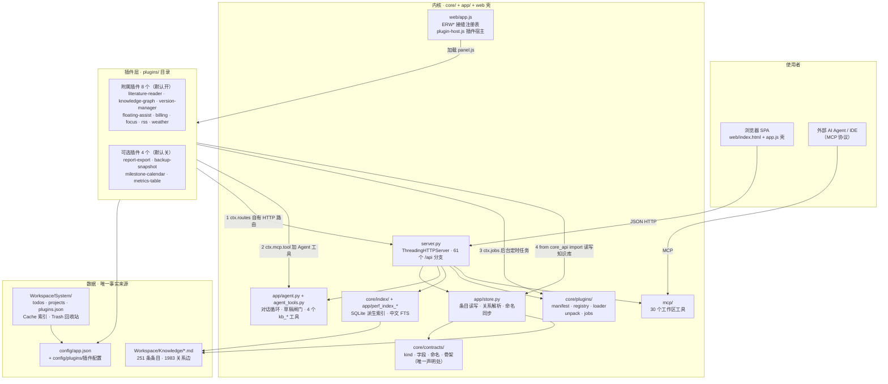
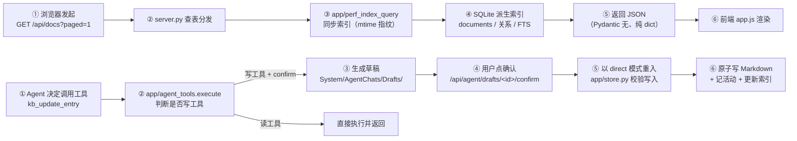
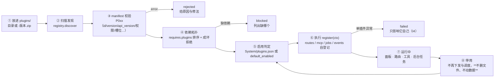

# 工程科研工作台 · 项目结构与功能总览

> 本文是**当前状态**的入口文档（结构 + 功能 + 插件）。深度内容各归其位：
> **使用教程**（带截图、分章）见 [`manual/`](manual/README.md)——也能在工作台侧栏「系统 → 使用手册」里读；
> 分层判据与路线图见 [`SCOPE.md`](SCOPE.md)，插件契约见 [`PLUGIN_SPEC.md`](PLUGIN_SPEC.md)，
> 改造历史见 [`REFACTOR_PLAN.md`](REFACTOR_PLAN.md) 与 [`../CHANGELOG.md`](../CHANGELOG.md)，
> 早期技术笔记（**部分已过时，仅作历史参考**）见 [`ARCHITECTURE.md`](ARCHITECTURE.md)。
>
> 文档版本：v261020.4 · 数据实测于 2026-10-20（251 条目 / 1983 关系边 / 5 项目 / 1 待办 / 12 插件）

---

## 一、这是什么

一个**本地优先**的科研知识工作台：文献、实验、笔记、里程碑都以 **Markdown + frontmatter** 落盘，
SQLite 索引只是可重建的派生物；前端是无构建步骤的原生 JS，后端是 Python 标准库 HTTP 服务。
它同时是 **AI Agent 的工作台**——Agent 通过受控工具读写知识库，写操作一律先出草稿等人确认。

设计的唯一判据：**零插件可跑**。把 `plugins/` 清空，知识库读写、检索、文献梳理、Agent 对话与设置页
必须照常工作——所有「具体功能」都应该是插件。

---

## 二、三层结构




> 上图由**上面那段 mermaid 源码生成**（`python tools/doc_check.py --export`）；改图请改源码，
> 不要改 SVG。mermaid 源码能在 GitHub / VS Code / Typora / Obsidian 里直接渲染。

| 层 | 位置 | 职责 | 硬约束 |
| --- | --- | --- | --- |
| **内核** | `core/` `app/` `web/app.js` `server.py` | 契约、索引、知识库、文献梳理、Agent 基础、界面壳、插件运行时 | 内核**不认识任何具体插件**（代码里 `grep` 不到插件名）；`core/` 不得 import `app`/`mcp` |
| **插件** | `plugins/<id>/` | 页面 · 槽位 · 设置 tab · HTTP 路由 · Agent 工具 · 后台任务 · 自有存储与配置 | 只许 `from core_api import …`；不改内核 DOM/CSS；不直写 `Workspace/` |
| **数据** | `Workspace/` `config/` | Markdown 是唯一事实来源；索引可重建 | 插件数据只落自己命名空间；知识条目一律走 `kb_*` 工具 |

**三条不变量**（`tools/plugin_check.py` 会拦）：

- **I1 零插件可跑**：空插件集是合法状态，不是故障；
- **I2 依赖单向**：内核不得 import 插件；
- **I3 插件只用门面**：插件后端只许 `from core_api import …`（`core_api.py` 169 行）。

---

## 三、目录结构

```text
engineering-research-workbench/
├─ server.py                 1161 行 · HTTP 服务与全部 /api 端点（61 个）
├─ client.py                 桌面窗口客户端（绑定失败时可挂到既有实例）
├─ core_api.py               466 行 · 插件唯一允许 import 的门面（I3）
├─ VERSION                   v261020.4
│
├─ app/                      后端 27 模块（不写前端的活）
│  ├─ store.py               1100 行 · 条目读写 + 关系解析 + 命名同步
│  ├─ agent.py               1028 行 · 对话循环 + 流式 + 草稿确认流
│  ├─ agent_tools.py         391 行 · 工具执行入口（内置 4 + 插件工具）
│  ├─ literature.py          788 行 · 文献：条目/PDF/批注/笔记/BibTeX
│  ├─ config.py              759 行 · config/app.json 读写与密钥解析
│  ├─ perf_index_db.py       312 行 ┐
│  ├─ perf_index_core.py     639 行 │ SQLite 派生索引
│  ├─ perf_index_query.py    461 行 │（建库/同步/查询/
│  ├─ perf_index_graph.py    270 行 │ 图谱/运行时维护）
│  ├─ perf_index_runtime.py  256 行 ┘
│  ├─ projects.py 421 · workspace.py 376 · scratch.py 253 · versions.py 494
│  ├─ todos.py 188 · activity.py 80
│  ├─ indexer.py             9 行 · 索引门面
│  └─ paths.py               25 行 · 打包/开发态的路径判定
│
├─ core/                     内核层（**不依赖 app / mcp**）
│  ├─ contracts/             kind 矩阵 · 命名规则 · 字段契约 · 工作区骨架
│  │  ├─ kinds.py            494 行 · 七类 kind、标记表、关系矩阵、骨架
│  │  ├─ naming.py           320 行 · 标题/命名校验
│  │  └─ validate.py         124 行 · 写入期字段校验
│  ├─ plugins/               插件运行时
│  │  ├─ manifest.py         393 行 · plugin.json 契约与 P0xx 校验
│  │  ├─ registry.py         320 行 · 发现/依赖拓扑/安装状态
│  │  ├─ loader.py           217 行 · register(ctx) 执行层 + 隔离
│  │  ├─ context.py          244 行 · ctx：routes/mcp/storage/config/events/jobs/raw
│  │  ├─ unpack.py           320 行 · 单文件包解包（六条规则）
│  │  ├─ jobs.py             234 行 · 后台任务调度（唯一调度线程）
│  │  └─ runtime.py / __main__.py · 当前加载结果 · CLI
│  ├─ index/                 索引迁移（migrations/）与维护
│  ├─ doctor.py              443 行 · 只读体检（error/warn 清单）
│  ├─ events.py              87 行 · 进程内事件总线（llm.usage 等）
│  └─ net.py                 107 行 · 出网兜底（代理指向回环且没监听时自动直连）
│
├─ plugins/                  插件库（12 个 + 模板；放进来即被发现）
│  ├─ .template/             模板：照它改就不用动内核
│  ├─ literature-reader/     v2.0.1 · PDF 阅读 + 批注 + 笔记 tab + 阅读区 AI
│  ├─ knowledge-graph/       图谱页与总览迷你图（整页接管）
│  ├─ floating-assist/       悬浮球 AI 助手（overlay 槽位）
│  ├─ billing/ focus/ rss/ weather/                附属插件
│  ├─ version-manager/       版本族：Agent 自动确认 / 逐节合并 / 归档取回（页面 + 路由 + 4 个 Agent 工具）
│  └─ report-export/ backup-snapshot/ milestone-calendar/ metrics-table/   可选插件
│
├─ web/                      前端（无构建步骤，server.py 直接提供）
│  ├─ app.js                 2147 行 · 界面壳 + ERW* 接缝注册表
│  ├─ perf-and-fetch-seam.js 性能补丁 + window.fetch 接缝提供方（须排在 app.js 之前）
│  ├─ research-pages.js      研究知识页补丁合并模块
│  ├─ layout-compact.css     紧凑布局（信息密度）· layout-fixes.{js,css} 版式修正
│  ├─ plugin-host.js         82 行 · 按装配清单加载插件前端
│  ├─ plugin-manager.js      493 行 · 设置页「插件」：启停/详情/演示预览
│  ├─ manual.{js,css}        内置使用手册阅读页
│  ├─ external-access.{js,css}  设置页「外部接入」：谁可以改知识库
│  ├─ manifest.json          装配清单 → 生成 index.html 的三段引用
│  ├─ styles.css + 其余补丁  版式与逐项补丁
│  └─ vendor/                pdfjs · mermaid · mathjax · marked · DOMPurify · hljs（本地副本）
│
├─ mcp/                      MCP 服务：15 个知识库工具 + 15 个工作区/待办/导出工具（共 30，另有插件工具）
├─ tools/                    运维与闸门脚本（27 个，见第九节）
├─ docs/                     本目录（架构与规范）
├─ config/                   app.json · secrets.json · external-access.json · plugins/<id>.json
├─ Workspace/                用户数据（gitignore + Syncthing 同步）
├─ build/ · *.exe            打包产物（PyInstaller）
├─ .scratch/                 临时数据：仅本地、不入库、7 天自动清理
├─ rag/                      早期 RAG 实验源码（仅 eval/，保留待复用）
└─ CHANGELOG.md · README.md · AGENTS.md · run.bat / run.sh
```

---

## 四、一条数据怎么流动



要点：**写路径只有一个闸门**——无论它来自内置工具还是插件工具，都在 `app/agent_tools.execute()`
里判断「是否写工具 / 是否 confirm 模式」，通过后才落盘；插件拿不到 `save_draft`，所以无法绕过。

---

## 五、插件的生命史



对应的用户可见动作：设置页里 **启用/停用**、查看权限与路由工具、编辑插件自己的配置、
**鼠标移到插件卡片看演示预览**（摘要 + 功能点 + 界面截图，由插件在 `plugin.json` 的 `preview` 里声明）。

---

## 六、插件一览（12 个）

**默认开启（附属插件，8 个）**

| 插件 | 提供什么 | 入口 | 权限 |
| --- | --- | --- | --- |
| `literature-reader` v2.0.1 | 文献阅读工作区：PDF 阅读 + 划选/框选批注 + 「笔记」tab（与知识库同源）+ 阅读区 AI（翻译/总结/提问/截图问图）+ 2 个 Agent 工具（写走草稿闸门） | 文献条目 PDF 徽章 | `ui:panel` `storage:own` |
| `knowledge-graph` | 知识图谱页与总览迷你图：力导向布局、筛选、搜索定位、节点预览与跳转、导出；**整页由插件渲染**，停用后只显示启用提示 | 侧栏「知识图谱」 | `ui:panel` |
| `floating-assist` | 悬浮球 AI 助手（常驻 `overlay` 槽位）：对话/流式、引用条目与文献、划词快捷动作、框选截图问图、工具轨迹、会话历史、人设编辑器、术语建档流水线 | 右下角悬浮球 | `ui:panel` |
| `billing` | 用量计费：订阅内核 `llm.usage` 事件逐条落账（次数/token/时长/花费/缓存命中率），按时间·模型·人设汇总 | 侧栏「用量统计」 | `storage:own` `config:own` |
| `focus` | 专注计时：专注/休息倒计时、环形进度、25/45/60/90 预设；设置存浏览器本地 | 侧栏「专注」 | `ui:panel` |
| `rss` | 科研资讯：RSS/Atom 聚合、arXiv 多级回退、缓存与离线降级、多源筛选 | 侧栏「资讯」 | `net:http` `storage:own` `config:own` |
| `weather` | 天气：顶栏槽位常驻温度+现象、逐日预报、地名解析、离线显示上次成功结果并说明原因 | 顶栏天气块 | `net:http` `storage:own` `config:own` |
| `version-manager` | 同一笔记的不同版本的查看/逐节合并/归档取回；**批量清理快照**与 **Agent 自动确认**（模型逐节选来源，失败回退规则）（数据模型在内核，本插件提供页面、路由与 4 个 Agent 工具） | 侧栏「版本」 | `ui:panel` `llm:use` |

**可选（默认关，4 个，设置里一键启用）**

| 插件 | 提供什么 | 亮点 |
| --- | --- | --- |
| `report-export` | 报告导出：项目/某类条目 → DOCX（**标准库写 OOXML，无需 python-docx**）/ HTML（浏览器打印成 PDF）/ Markdown | 产出文件走 `ctx.raw`；2 个 Agent 工具 |
| `backup-snapshot` | 备份与快照：知识库+配置打 zip，内核后台任务按间隔自动备份、按份数清理、可查看内容/下载、目标目录可外置 | 不做自动恢复（覆盖数据须人确认） |
| `milestone-calendar` | 日历：里程碑/待办到期分桶 + 月历 + **顶栏常驻角标**（逾期/今日） | 刻意不做系统通知（无常驻通道之外的通知能力） |
| `metrics-table` | 指标表：直接读条目正文的 **Markdown 表格与 `metrics` 块** → 按来源表分组 + **按对象透视跨实验对照** + CSV/Markdown 导出 | 零改写现有数据；写工具走草稿闸门 |

> 每个插件都有 `plugin.json`、可选的 `backend.py`、`web/panel.js(+css)`、`README.md` 与
> `web/preview.png`（演示预览截图）。目录与写作约定见 [`../plugins/README.md`](../plugins/README.md)。

---

## 七、内核功能清单

| 能力 | 落点 | 要点 |
| --- | --- | --- |
| **知识库契约** | `core/contracts/` | 七类 kind（灵感/研究日志/笔记/实验/里程碑/工作总结/文献）、类别词（架构/方法/模型/原理/数据集）、10 个内置标记（默认启用 3 个，其余在设置页按需添加）、关系矩阵；标题命名与存放是**硬约束**，`level=error` 会被工具拒写 |
| **条目读写** | `app/store.py` | 原子写、frontmatter 解析、关系解析（`[[wikilink]]` 与关系层）、命名同步、回收站（`System/Trash/<kind>/`） |
| **派生索引与检索** | `app/perf_index_*` `core/index/` | SQLite（schema v4）：文档/关系/待办/FTS；中文分词检索；可整库重建；迁移框架；WAL checkpoint |
| **项目与待办** | `app/projects.py` `app/todos.py` | 项目注册表（稳定 `project_id`）、项目文件树、待办清单、活动日志（追加型 JSONL） |
| **文献** | `app/literature.py` | 条目/元数据/阅读状态/BibTeX 导出/互链；PDF 存储与 Range 分片、批注、笔记（与知识库同源） |
| **科研 Agent** | `app/agent.py` `app/agent_tools.py` | 对话循环 + SSE 流式 + 上下文注入 + **4 个内核内置工具**（`kb_search/kb_read/kb_create_entry/kb_update_entry`，写工具走草稿闸门）+ 人设与工具白名单 + 请求模式 + 写作规范注入；版本族 4 个工具（`versions/auto_merge_versions/merge_versions/archive_versions`）由 `version-manager` 插件登记，停用则不可用 |
| **多版本与来源（数据面）** | `app/versions.py` `app/store.py` `app/activity.py` | 同一笔记的不同版本归成**版本族**（`variant_of`/`variant_label`，外部工具按标题签名自动归族）；四条写入路径（界面/Agent/MCP/插件）都记**来源**（`origin_surface/tool/client/at`，活动日志带 `source`）；**分叉/冲突时先留一版**；归档到 `System/Versions/<基条>/archived/` 可追溯。**界面与工具在 `version-manager` 插件**（v261009.44 起；停用则入口消失，数据仍在） |
| **设置与运维** | `app/config.py` `server.py` | `config/app.json` 全量设置页、Workspace 迁移、索引重建、快速重启、**插件管理**（启停/权限/路由/工具/依赖/配置/预览） |
| **MCP 服务** | `mcp/` | 30 个工具（`kb_*` 15 + `ws_*`/`todo_*`/导出 15；插件工具以 `p_<id>__<tool>` 动态并入），供外部 AI Agent/IDE 直接操作工作区 |
| **界面壳** | `web/app.js` `web/manifest.json` | 14 个内核页面 + `ERW*` 接缝注册表（插件自登记点）+ 装配清单生成 `index.html` 引用块 |

**浏览器里可导航页面 = 19 个**：内核 14（概览/项目/待办/Agent｜灵感/研究日志/笔记/实验/里程碑/工作总结/文献/知识图谱｜文件夹｜设置）
+ 当前启用插件贡献 5（专注、日历、资讯、用量统计、版本）。

---

## 八、数据与文件位置

| 位置 | 内容 | 谁写 |
| --- | --- | --- |
| `Workspace/Knowledge/<KindDir>/<id>.md` | 七类条目的 Markdown（**唯一事实来源**，扁平存放） | 内核（`kb_*` 工具） |
| `Workspace/Projects/<项目>/` | 项目的 Notes/Experiments/Data/Results/Figures/Manuscript/References | 用户与内核 |
| `Workspace/System/todos.json` · `projects.json` · `plugins.json` · `activity.jsonl` | 待办、项目注册表、插件启停意图、活动日志 | 内核 |
| `Workspace/System/Cache/index.sqlite` | 派生索引（**可重建**） | 内核 |
| `Workspace/System/Trash/…` | 回收站（条目/文献/项目/插件） | 内核 |
| `Workspace/System/AgentChats/` | 会话与草稿（`Drafts/` 就地持久化，重启不丢） | 内核 |
| `Workspace/System/Plugins/<id>/` · `Workspace/Plugins/<id>/` | 插件自有系统数据与用户数据 | 插件（经 `ctx.storage`） |
| `config/app.json` · `config/secrets.json` | 内核设置与密钥（Ak 只存环境变量名或本地私密文件） | 内核/用户 |
| `config/plugins/<id>.json` | 插件自己的配置（内核不解释内容） | 插件（经 `ctx.config_write`） |

---

## 九、闸门与验证（改完必须跑）

| 脚本 | 管什么 |
| --- | --- |
| `python tools/kb_smoke.py` | 知识库冒烟：条目读写、字段、命名、回收站 |
| `python tools/web_check.py` | 前端静态：语法、装配清单一致、`window.ERW*` 接缝提供/消费、加载顺序 |
| `python tools/ui_smoke.py --base-url …` | 真浏览器走查：每条路由可渲染、0 console error、首屏不拉重型库 |
| `python tools/plugin_check.py --assert-core-only` | 插件隔离：I2/I3、`core/` 不依赖 `app`、零插件可跑 |
| `python tools/web_manifest.py --check` | `index.html` 与 `web/manifest.json` 是否漂移（改了前端必跑） |
| `python -m core.doctor` | 只读体检（数据/索引/契约漂移；**error 0 才算健康**） |
| `python -m core.plugins list\|check <id>\|verify` | 插件发现 / 单插件校验 / 全库盘点（`list --install` 顺带解包） |
| `python tools/new_plugin.py <id> --name "名称"` | 从模板生成新插件（先临时后原子、用安装期同一套校验） |
| `python -m mcp.server --selftest` | MCP 工具表自检 |

> **前端补丁文件改名对照（v261009.39）**：`v260922-*` 这类"日期命名"已按功能重命名，
> 旧文档/CHANGELOG 里的名字按此表对应：
> `v260922-performance.js` → **`perf-and-fetch-seam.js`** ·
> `v260922-performance.css` → `perf-affordances.css` ·
> `v260922-compact-layout.css` → `layout-compact.css` ·
> `v260922-agent-profiles.css` → `sidebar-agent-profiles.css` ·
> `v260922-graph-performance.css` → `graph-page-layers.css` ·
> `v260922-layout-bugfixes.{css,js}` → `layout-fixes.{css,js}` ·
> `v260922-overview-editor-tools.css` → `overview-editor-tools.css` ·
> `v260922-projects.css` → `projects-manager.css` ·
> `v260922-research-pages.js` → `research-pages.js`。
> 加载顺序约束（接缝提供方排在 `app.js` 之前）由 `tools/web_check.py` 守着。

当前健康度（2026-10-20 实测）：`doctor` **error 1 / warn 4**——error 为 2 条 journal 标题超长，待用 `kb_rename_entry` 改名；插件 12 个可用、0 blocked/rejected/冲突。

---

## 十、想加功能？先看这张表

| 想做的事 | 怎么做 | 要不要动内核 |
| --- | --- | --- |
| 加一个页面 / 顶栏组件 / 设置 tab / 阅读区 tab | `ERWPanels.register` + manifest `nav[]`/`panel` | 不用 |
| 提供 HTTP 接口 | `ctx.routes.get/post(相对路径, handler)` → `/api/plugins/<id>/…` | 不用 |
| 给 Agent 加工具（含写工具） | `ctx.mcp.tool(名, {"write": true}, handler)` | 不用 |
| 定时任务 / 订阅事件 | `ctx.jobs.add(...)` / `ctx.events.on("llm.usage", ...)` | 不用 |
| 读知识库 / 写条目正文 | `core_api.entries/entry` / `core_api.entry_update` | 不用 |
| 产出文件给用户下载 | `ctx.raw(bytes, content_type=…, filename=…)` | 不用 |
| 存自己的数据与配置 | `ctx.storage` / `ctx.config_read|write` | 不用 |
| 接管整页 / 常驻容器 / 插件间协作契约 | 需要内核先加一种「形态」（注册表 + 一处委托） | 要（一次性） |
| 新增一种 kind / 搜索分区 / 独立进程插件 | 需要内核先实现该能力（当前缺口：`ctx.search.addSection`、`process` 执行层） | 要 |

**三步做出一个插件**：

```powershell
python tools/new_plugin.py my-tool --name "我的工具"   # ① 从模板生成（先校验后落盘）
# ② 改 backend.py（路由/工具/配置）与 web/panel.js（界面）——不需要动内核任何文件
python -m core.plugins check my-tool                   # ③ 校验 → 重启工作台 → 在设置页启用
```

规范细节：[`PLUGIN_SPEC.md`](PLUGIN_SPEC.md)（§2 包格式与解包规则、§3 字段、§6 隔离与接缝、
§13 上手与兼容性承诺）；模板：[`../plugins/.template/`](../plugins/.template/)。
