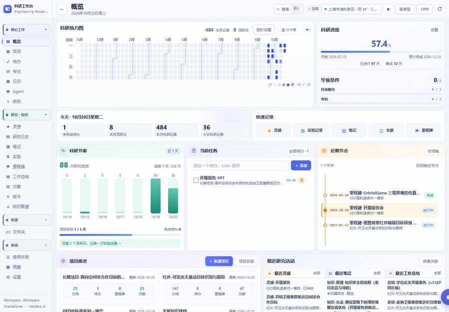
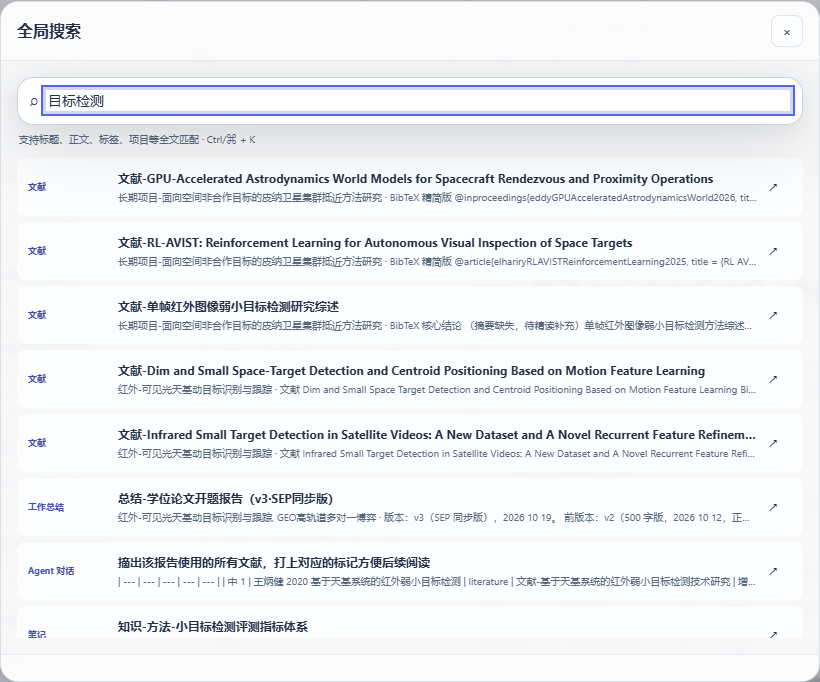
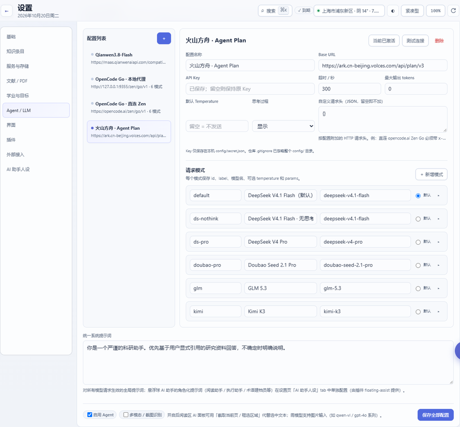

# 一、快速开始

## 1. 启动工作台

| 方式 | 命令 | 适用 |
| --- | --- | --- |
| 打包版 | 双击 `ResearchWorkbench.exe`（或 `run.bat`） | 日常使用 |
| 源码 | `python server.py` | 开发 / 改了代码 |
| 只重启后端 | 设置 → 服务与存储 → **保存后快速重启** | 改了 Host/Port/Workspace |

启动后浏览器打开 `http://127.0.0.1:8765`（端口可在设置里改）。**改了 `/app`、`/core`、`/mcp` 里的 Python 代码必须重启**；
只改 `web/` 或插件前端，刷新页面即可。

## 2. 界面总览

- **左侧栏**分四组：`核心工作`（概览、项目、待办、日历、Agent，以及插件加的入口）、`研究 · 知识`（灵感 / 研究日志 / 笔记 / 实验 / 里程碑 / 工作总结 / 文献 / 知识图谱）、`资源`（文件夹）、`系统`（设置、使用手册）。
  分组标题可折叠，点 **◆** 可固定展开。插件页面（日历、资讯、专注、用量…）由插件自己登记分组；停用插件后对应入口会消失。
- **顶栏**：左侧是页面标题与副标题，右侧是全局搜索框与主题切换；装了天气插件时这里还会多一个天气块。
  - 快捷键 **Ctrl/⌘ + K** 打开全局搜索。
- **主区**：每个页面的内容。多数条目页是「左侧列表 + 右侧编辑器」两栏。
- 右下角可能有**悬浮球**（AI 助手插件提供）；没有插件时它就不出现，不影响任何内核功能。

## 3. 第一分钟：四件事

### ① 建一个项目（可选但推荐）

概览页「**项目推进**」卡片 → **新建项目** → 输入名称（如「红外弱小目标检测」）→ 创建。

工作台会自动在 `Workspace/Projects/<项目名>/` 下建七个标准子目录：
`Notes` `Experiments` `Data` `Results` `Figures` `Manuscript` `References`，并把项目登记进项目注册表。
之后写条目时可以把它**关联到这个项目**，检索、图谱、总览都会按项目聚合。

### ② 写第一条笔记

1. 侧栏 → **笔记**；
2. 点列表上方的 **＋**：工作台立刻创建一条 `未命名笔记` 并打开它（**不会弹窗问你名字**，因为标题就在编辑器里改）；
3. 在「条目信息」区改**标题**（命名规则见[第二章](02-知识库条目.md)）、选**状态**、加**标签**、勾**分类标记**；
4. 在下方写正文（支持 Markdown：标题、列表、表格、代码块、公式、mermaid 图）；
5. 点右下 **保存**（或按工具栏的保存）。保存后左侧列表、检索、图谱都是最新的。

### ③ 试试全局搜索

按 **Ctrl/⌘ + K**，输入任意关键词（标题、正文、标签、项目都能命中）：

点结果行直接跳到那条记录。搜索走的是**内核的中文全文索引**（FTS），不是模糊前端过滤。

### ④ 配好 Agent 的模型（要用 AI 的话）

设置 → **Agent / LLM**：

1. 在「Agent API 配置」里填 **Base URL / 模型 / API Key**（或先建一条 profile，再点「设为当前配置」）；
2. Key 建议放 `config/secrets.json` 或环境变量（见[第七章](07-设置运维与边界.md)的隐私说明），不要写进会同步的笔记里；
3. 保存后回 Agent 页提问即可。**第一次提问前建议先问一个只读问题**（如「我最近有哪些实验？」），确认工具链路通了。

## 4. 之后怎么用

- 想**找东西** → Ctrl+K，或去对应条目页用筛选；
- 想**记东西** → 选对类别再写（笔记 vs 实验 vs 灵感 vs 里程碑的用途不同，见第二章）；
- 想**让 AI 干活** → Agent 页提问；涉及修改数据时它会出草稿等你确认；
- 想**看全局** → 概览页（今日/研究节律/项目推进/最近研究活动）与「研究 · 知识 → 总览」；
- 想知道**数据在哪** → 第七章有完整的「哪个文件存什么」表。
