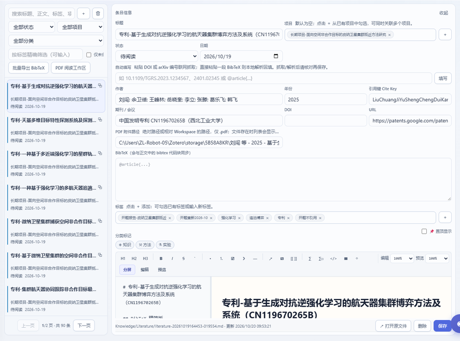
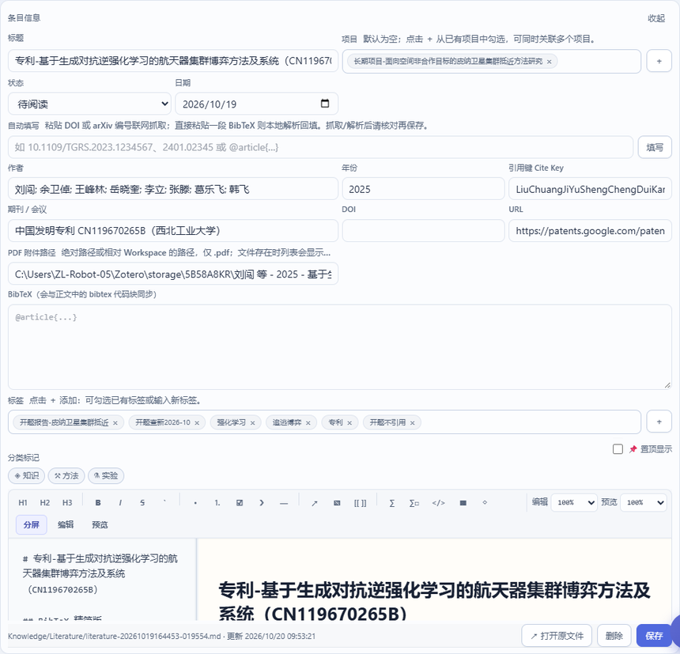

# 四、文献

文献是知识库里的第七类条目（`Knowledge/Literature/`），比普通条目多一组**书目字段**，
并且和 PDF、批注、笔记、BibTeX 导出打通。**梳理与阅读进内核**：条目、元数据、阅读状态、
BibTeX 导出、PDF 存储都由内核负责。

## 1. 文献列表与筛选

侧栏「研究 · 知识 → 文献」：



- 卡片显示标题、作者年份、状态（待阅读 / 阅读中 / 已读…）、标签、项目、附件徽章；
- 左侧筛选与其它条目页一致（搜索 / 状态 / 项目 / 分类 / 标签）；
- 顶部两个动作：
  - **批量导出 BibTeX**：把当前**筛选结果**导出成 `.bib`（写进 `Knowledge/Exports/BibTeX/`）；
  - **PDF 阅读工作区**：进入阅读界面（该入口由阅读插件提供；插件停用则此按钮不出现）。

## 2. 文献条目：书目字段

点开一条文献，右侧编辑器上方是它的书目信息：



| 字段 | 说明 |
| --- | --- |
| 标题 | 仍按命名规范：论文 `文献-<原标题>`，专利 `专利-<专利名>`（两者同属文献类型） |
| 作者 authors | 逗号分隔；用于导出 BibTeX 的 `author` |
| 年份 year / 期刊会议 venue | 排序与引用展示 |
| DOI / URL | 点击可跳转；DOI 可用于去重与查证 |
| cite_key | BibTeX 引用键；留空时导出会按规则生成 |
| 附件 | 关联的 PDF（存在 `Knowledge/Literature/PDF/`，或你在设置里指定的外部目录） |
| 状态 | 待阅读 / 阅读中 / 已读 等，用于驱动「今天读什么」 |
| 标签 / 项目 | 与普通条目一致；建议给文献打「学习阶段」「主题」两类标签 |

正文里可以放**自己的结构化笔记**（摘要、方法、可复用点、与我工作的关系）。若条目里带
````bibtex` 代码块，导出时以块内内容为准，便于手工校正。

## 3. 导入文献

三种入口：

1. **界面导入**：文献页的导入入口（内核 `/api/literature/import`）——给 DOI / arXiv ID / 标题，抓元数据并建档；
2. **Agent**：直接让 Agent 建（它用 `kb_create_entry`，kind=literature），适合一次整理一批；
3. **手工**：`＋` 新建一条文献条目，自己填字段。

导入时若库里已有同 DOI / 同标题的条目，**先搜索再建**（`Ctrl/⌘+K` 或 Agent 的 `kb_search`），避免重复。

## 4. PDF 存放目录（设置里管理）

设置 → **文献 / PDF**：

- **PDF 存放目录**：支持 `Workspace/` 内相对路径或任意绝对路径（如 `D:\Papers\PDF`）；
  保存时勾「迁移现有 PDF」会把旧目录的文件搬过去并**回写条目的附件指向**（Workspace 内为移动，外部路径保留原件复制）；
- **笔记图片目录**：批注截图、笔记插图统一存这里；只影响之后上传的图片；
- **重建关联**：以文献条目为准，补齐 PDF 工作区关联与登记（换了目录、手工搬过文件之后跑一次）；
- **打开 PDF 文件夹**：直接跳转到系统文件管理器。

## 5. BibTeX 导出与论文写作

1. 在文献页筛出要引用的条目（可按项目/标签/状态）；
2. 点 **批量导出 BibTeX** → 生成 `.bib`；
3. 把这个文件放进你的 LaTeX 工程（或 `Manuscript/`），用 `\cite{cite_key}` 引用。

导出的字段来自条目本身，**所以改条目就是改引用**：年份错了就在条目里改，不要改 `.bib`。

## 6. 批注与笔记

- **批注**：在阅读界面里划选/框选，批注随附件数据保存，可在条目里回看（阅读界面由插件提供）；
- **笔记**：文献笔记与知识库条目**同源**——它就是该条目正文的一部分，因此检索、图谱、导出、备份都自动覆盖它；
- 从批注「加入笔记」会把选区内容追加进笔记正文（这一步会写文件，因此同样受"先确认再落盘"的约束）。

## 7. 本章常见问题

| 现象 | 处理 |
| --- | --- |
| 附件徽章在但打不开 | PDF 被移走了：设置里点「重建关联」，或把文件放回 `Knowledge/Literature/PDF/` |
| BibTeX 少了某条 | 该条目的 `cite_key` / 年份 / 作者为空；补全后重新导出 |
| 同一篇文献建了两次 | 用 DOI 搜索确认；确认重复后删掉一条（进回收站），保留被引用更多的那个 |
| 想换 PDF 目录 | 设置 → 文献 / PDF → 填新路径 → 勾迁移 → 保存并应用（会回写附件指向） |
