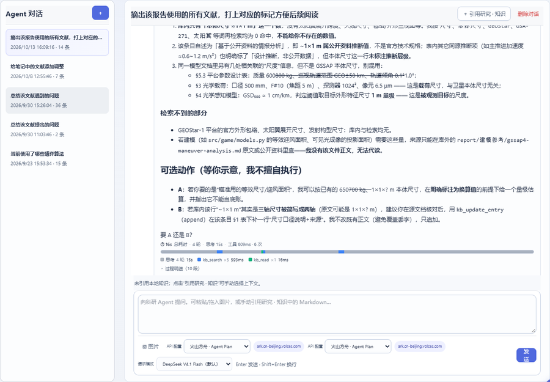
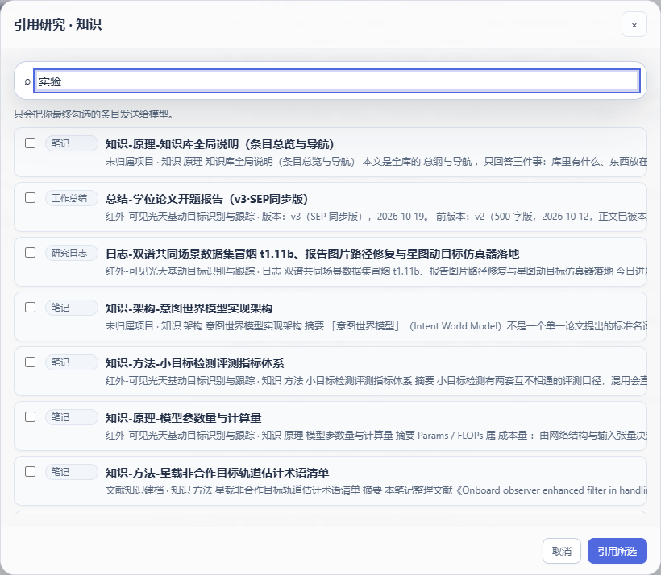

# 五、科研 Agent

Agent 是内核对外的 AI 入口：**对话 + 受控工具**。它最重要的性质不是"能聊天"，而是
**写操作一律先出草稿、等你确认**——所以可以让它改知识库，而不必担心数据被悄悄改坏。

## 1. 界面

侧栏「核心工作 → Agent」：



- **左栏**：本地对话历史（每个会话显示标题、时间、条数），`＋` 新建，`删除对话` 移入 Trash；
- **中栏**：消息流。用户消息可带引用条目与图片；助手消息里可能含**工具轨迹**（调了哪些工具、各花多久）；
- **输入区**：文本框 + 一排动作
  - **＋ 引用研究 · 知识**：挑几条本地条目作为上下文（见下）；
  - **▧ 图片**：附图提问（可粘贴/拖入）；
  - **请求模式**：本轮用哪套模型参数（在设置里维护）；
  - `Enter` 发送、`Shift+Enter` 换行。

## 2. 引用本地知识（让它"看着你的资料"回答）

点 **＋ 引用研究 · 知识**：



搜索并勾选条目 → 应用 → 这些条目的正文会被注入本轮上下文（输入区上方会出现引用条）。
适合："按 [[知识-方法-小区域滤波]] 的口径，帮我检查这份实验设计有没有漏项"。

> 上下文不必全靠手工：Agent 也可以**自己调工具**去检索（`kb_search` / `kb_read`），
> 引用选择器是"我明确要它看这几篇"的快捷方式。

## 3. 模型与请求模式

设置 → **Agent / LLM**：


| 区块 | 作用 |
| --- | --- |
| **Agent API 配置** | 一套 profile = Base URL + 模型 + Key（+ 可选自定义请求头）。可存多套，用「设为当前配置」切换 |
| **请求模式** | 一组模型参数组合（如"默认""高思考""· 无思考"），Agent 页下拉选择；也可给不同模式指定不同模型 |
| **人设** | 系统提示词 + 工具白名单 + 写模式 + 温度；内置 reader（只读）/ executor（全量）/ archivist（建档员） |
| **统一系统提示词 / 写作规范** | 拼在所有人设最前面的公共约束；写作规范文件在 `Workspace/System/AI助手写作与建档规范.md`，**改文档即改 AI 行为** |
| **多模态开关** | 是否允许附图提问 |

> 密钥只存"环境变量名"或本地私密文件 `config/secrets.json`；**不会进 Workspace、不会进会话文件**。

## 4. 写操作：草稿确认流（必读）

这是 Agent 最该理解的一段。

**规则**：Agent 的写工具（建条目 / 改条目 / 写文献笔记）在默认的 `confirm` 模式下**只生成草稿**，
草稿存在 `Workspace/System/AgentChats/Drafts/`（重启不丢），**确认后才落盘**。

**流程**：

1. 你对 Agent 说："把刚才的实验结果记成一条实验条目，编号 3.1"；
2. Agent 调 `kb_create_entry`（写工具）→ 内核**不执行**，而是返回一张**草稿卡**；
3. 草稿卡上显示将要写入的 kind / 标题 / 正文预览，两个按钮：**确认** / **拒绝**；
4. 点**确认** → 内核以 `direct` 模式重放这次调用，真正落盘（原子写 + 记活动 + 更新索引）；
   点**拒绝** → 什么都不发生；
5. 一条消息里产生多张草稿时，会出现**批量操作条**，可一键全部确认/拒绝。

**写模式**（两条路取**更严格**者）：页面上的写模式开关与人设里的 `write_mode` 同时为 `direct` 才会直写；
只要有一个是 confirm，就仍然出草稿。**建议保持 confirm**——它是数据安全的最后一道闸门。

**直写的代价**：省一次点击，但一旦模型理解错了标题或正文结构，错误会直接落盘（虽然还能从回收站/备份恢复）。

## 5. 工具与边界

内核给 Agent 的工具（内置）：

| 工具 | 读写 | 说明 |
| --- | --- | --- |
| `kb_search` | 读 | 检索知识库（标题/正文/标签/项目） |
| `kb_read` | 读 | 读某条条目的完整正文 |
| `kb_create_entry` | **写** | 建条目（走草稿闸门） |
| `kb_update_entry` | **写** | 改条目（走草稿闸门） |

装了插件后工具面会扩大（插件工具名前缀 `p_<插件id>__<工具>`），**插件写工具同样走草稿闸门**——
闸门在内核侧，插件无法绕过。人设的**工具白名单**可以进一步收窄某个角色能用的工具（例如只读人设禁用一切写工具）。

## 6. 给外部 Agent / IDE 用（MCP）

工作台自带 MCP 服务（25 个工具：知识库 CRUD、工作区/项目/待办/文献导出等），可被支持 MCP 的
AI 客户端直接调用：

```powershell
python -m mcp.server            # 启动 MCP 服务（stdio）
python -m mcp.server --selftest # 自检工具表
```

接入方式见 [`mcp/README.md`](../../mcp/README.md)。注意：MCP 侧的工具直接操作知识库，
**不经过界面上的草稿确认**——请只在受信任的客户端里启用它。

## 7. 本章常见问题

| 现象 | 处理 |
| --- | --- |
| 提问没反应 / 报错 | 先在设置里点「测试连接」；确认 Base URL、模型名、Key；有些网关需要自定义请求头 |
| 它说"没有权限调用工具" | 当前人设的工具白名单不含该工具：换 executor 人设，或在设置里给人设加白名单 |
| 它答得慢 | 看助手消息里的**工具轨迹**：是模型慢还是工具慢（检索/文献读取）；换更快的请求模式 |
| 它改了标题却报命名错误 | 说明草稿没通过内核校验——这是**设计如此**：不合规的写入会被拒，按提示修正后重试 |
| 想让它按固定格式写 | 改 `Workspace/System/AI助手写作与建档规范.md`（所有人生效），或给该人设写系统提示词 |
