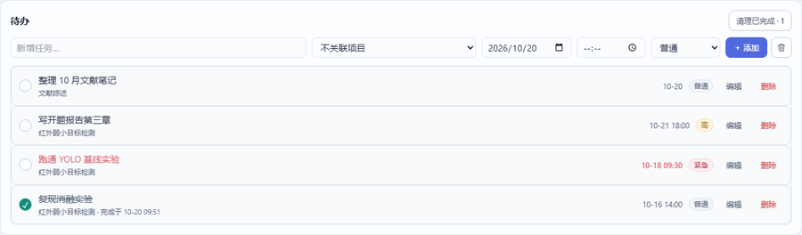
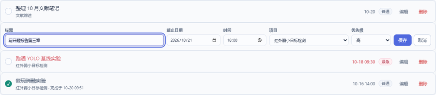
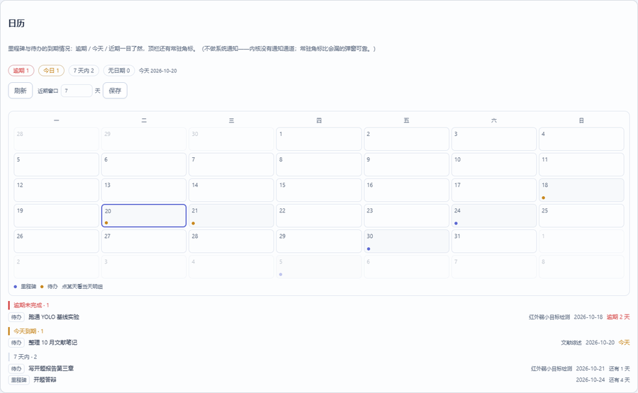
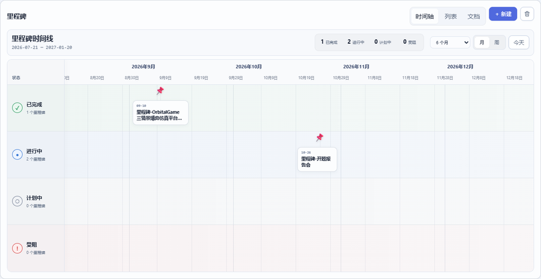

# 六、项目、待办、日历与里程碑

## 1. 项目：把研究拆成有目录的单元

**建项目**：概览 → 「项目推进」卡 → **新建项目** → 输入名称。
工作台自动创建七个标准子目录并登记项目：

```text
Workspace/Projects/<项目名>/
├─ Notes/         过程笔记、会议记录
├─ Experiments/   实验脚本与配置
├─ Data/          原始数据（大文件放这里，注意体积）
├─ Results/       结果表格/日志/中间产物
├─ Figures/       出图
├─ Manuscript/    稿件（含 .bib 引用）
└─ References/    参考资料
```

**项目怎么用**：

- 条目（笔记/实验/文献/里程碑…）都能关联到项目（编辑器「项目」字段，支持多项目）；
- 概览的「项目推进」卡按项目汇总：条目数、未完成待办、近期里程碑；
- 项目记录页（`/api/project-records`）给出每个项目的状态、最近更新、文档数；
- 项目本身也有状态（进行中 / 暂停 / 完成 / 归档），在项目记录里维护。

> 跨项目通用的知识（某条评测口径、某个方法的原理）**不要**硬塞进项目：让它「未归属」并打「通用基础」标签，
> 这样它既不会被算进某个项目的进度，又能被所有项目引用。

## 2. 待办：今天/本周要干的事

侧栏「核心工作 → 待办」：



### 2.1 新增

输入标题 → 选**项目**（可不选）→ 选**截止日期**与**时间** → 选**优先级**（紧急/高/普通/低）→ 点 **添加**。

- **时间可以留空**：留空表示「当天结束前完成」，判定上按 **当天 23:59** 截止；
- 填了时间就精确到分（如 `2026-10-20 18:00`），排序与逾期判断都用这个时刻；
- 概览页的快捷添加只会填标题（截止日默认今天），之后可以在待办页补时间。

### 2.2 编辑：行内表单，不弹窗

每行右侧都有 **编辑**，点开就在原地展开表单：



- 能改 **标题 / 截止日期 / 时间 / 项目 / 优先级** 五项；
- **Enter 保存、Esc 取消**；保存后列表、首页任务卡与日历都会跟着更新；
- 只改一项也没问题：表单里其余字段保持原值，不会因为没动就被清掉；
- 标题不能为空；留空会被前端拦下并提示。

### 2.3 完成与「完成时间限制」

勾选左侧圆圈（再次点击可恢复待办）。这里有一条**完成时间限制**：

1. **截止时间精确到分**。只填日期的待办，到当天 23:59 才算逾期；
2. **逾期仍可完成，但要二次确认**：点了完成后会弹「确认完成已逾期的…」，确认后才真正落盘；
   服务端同样会拦（返回 `409 requires_confirm`），所以即使页面数据比后端旧，也不会悄悄完成；
3. **记录实际完成时间**：完成时写入 `completed_at`，列表里显示「完成于 10-20 09:51」；
   把待办**恢复**成未完成后，这个时间会被清空，避免留下旧记录；
4. **逾期标红**：未完成且过了截止点的条目，时间和标题同时标红，一眼能看出哪条拖了；
5. **完成 ≠ 删除**：完成的待办保留在列表里可回看，右上「清理已完成 · N」才真正删掉它们；
6. 活动日志里会记一条「完成任务」，概览的「科研节奏」也用它统计。

> 服务端字段：`due`（`YYYY-MM-DD` 或 `YYYY-MM-DD HH:MM`）、`completed_at`（完成时刻）、`overdue`（读取时派生）。
> 通过 MCP / 外部工具改待办时，逾期完成要显式带 `force: true`，等同于界面上的二次确认。

### 2.4 排序与清理

- 未完成在前；同一状态内按「离现在的截止时刻」由近到远，再按优先级、再按截止时间；
- 没有截止日的条目排在最后；
- 全部勾选、批量删除要先用列表右上角的批量按钮进入选择模式。

## 3. 日历：到期视图（插件）

侧栏「**核心工作 → 日历**」（在待办之后、Agent 之前）：



- **月历**：每周一起始，有到期的日子带圆点（蓝＝里程碑、黄＝待办）；点某一天看当天明细；
- **四段清单**：逾期未完成 / 今天到期 / 近期（默认 7 天，可改）/ 无日期（待安排）；
- **顶栏常驻角标**：`⚠ 逾期数`、`◔ 今日数`，切到别的页面也在；没有到期项时显示 `✓ 到期`；
  点角标直接跳到日历页；
- **数据来源**：里程碑的 `due` + 未完成待办的 `due`（已完成的不参与提醒），与待办/里程碑页同源，
  不会出现「两处数不一致」；
- **近期窗口**：页面里改天数 → 保存，存进插件自己的配置 `config/plugins/milestone-calendar.json`；
- 日历是**插件**提供的：在「设置 → 插件」里停用它，入口和角标一起消失，其余功能不受影响。
  插件的启用/停用、安装与开发见[第八章](08-插件使用与开发.md)。

## 4. 里程碑：有验收条件的节点

侧栏「研究 · 知识 → 里程碑」：



三种视图（右上切换）：

| 视图 | 用途 |
| --- | --- |
| **时间轴** | 按日期铺开，看阶段节奏与依赖顺序 |
| **3D 时间线** | 空间化展示（节点高低/前后代表阶段与权重），适合汇报与总览 |
| **文档** | 左侧列表 + 右侧编辑器，就是里程碑条目的正文编辑 |

**里程碑条目要有**：目标、**验收条件**（可判定的，如"mIoU ≥ 0.75 且虚警 ≤ 1e-5"）、
依赖的前置实验、截止日期（`due`）。到期提醒走顶栏角标与日历页。

## 5. 待办、日历与里程碑怎么配合（推荐节奏）

1. **阶段开始**：建 1–2 个里程碑（写清验收条件），把要做的事拆成若干待办并关联项目；
2. **每天**：待办页勾掉完成的；随手写日志/灵感；实验结束就写一条实验条目并把结果贴进去；
3. **每周**：用 Agent 或手工写一条工作总结，引用本周的实验与笔记（互链）；在日历页看一眼「逾期 / 近期」；
4. **阶段收口**：里程碑打勾（状态改「完成」），跑一次 `python -m core.doctor` 看有没有断链与命名漂移；
5. **要交付时**：文献页导出 BibTeX，报告导出走插件（设置里启用「报告导出」）。

## 6. 本章常见问题

| 现象 | 处理 |
| --- | --- |
| 项目删不掉 | 项目里还有条目/待办关联：先把它们改到别的项目或取消归属 |
| 里程碑不在时间轴上 | 缺 `due`（截止日期）或 `record_date`；补上即可 |
| 待办列表看不到某项目 | 待办页默认全量显示；搜索框输入项目名即可过滤 |
| 逾期待办点完成没反应 | 会先弹二次确认；确认后才会保存（服务端也会再校验一次） |
| 完成时间不对/没有 | 「完成于」记的是实际完成那一刻；恢复待办会清空，重新完成会重新记 |
| 日历页或顶栏角标不见了 | 日历是插件：设置 → 插件里确认「日历」处于启用状态 |
| 想给项目加自定义目录 | 文件夹页新建目录即可；标准七目录只是初始骨架，不限制你扩展 |
