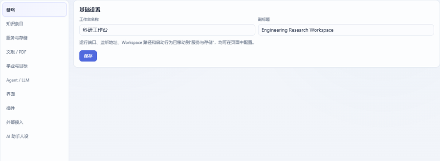
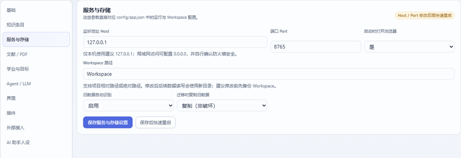

# 七、设置、运维与边界

## 1. 设置页各栏

设置页（侧栏「系统 → 设置」）左侧是一排 tab，逐栏说明：



| tab | 管什么 | 注意 |
| --- | --- | --- |
| **基础** | 工作台名称、副标题 | 立即生效 |
| **服务与存储** | Host、Port、启动是否开浏览器、**Workspace 路径**、旧数据自动识别与复制、**保存后快速重启** | 改 Host/Port/Workspace **需要重启**；换 Workspace 前先备份 |
| **文献 / PDF** | PDF 存放目录、笔记图片目录、重建关联 | 见[第四章](04-文献.md) |
| **学业与目标** | 学业档案（毕业条件、目标专利/论文数等），驱动概览的进度卡 | 只影响展示 |
| **Agent / LLM** | API 配置、请求模式、人设、统一提示词、多模态开关 | 见[第五章](05-科研Agent.md) |
| **界面** | 主题、密度、侧栏分组折叠状态等外观项 | 存浏览器本地 |
| **外部接入** | **谁可以改知识库**：① 允许外部 MCP 客户端写入（默认**关闭**＝只读）② 允许插件写入知识库（默认开启） | 内核 Agent 的写操作走草稿确认、不受这里影响；关掉插件写入＝只读工作台 |
| **插件** | 插件启停、权限/路由/工具/依赖/目录、插件配置、**演示预览**（悬停卡片） | 用法与开发见[第八章](08-插件使用与开发.md)；插件功能各自看插件 README |



服务与存储这一页的三件事值得单独记住：

1. **Workspace 路径**：所有数据的位置。支持相对项目目录或绝对路径；
2. **旧数据自动识别 / 迁移时复制**：从旧目录切过来时，可"识别"或"复制（非破坏）"；
3. **保存后快速重启**：改完 Host/Port/Workspace 点它，服务原地重启（比手动关开更稳）。

## 2. 数据放在哪（一张表说清）

| 位置 | 内容 | 能不能删 |
| --- | --- | --- |
| `Workspace/Knowledge/<KindDir>/*.md` | **全部知识条目**（唯一事实来源） | ❌ 不能删；这就是你的成果 |
| `Workspace/Projects/<项目>/` | 项目文件（数据/图/稿件） | 自己判断 |
| `Workspace/System/todos.json` · `projects.json` · `plugins.json` · `activity.jsonl` | 待办、项目注册表、插件启停、活动日志（只增） | ❌ 不建议手改 |
| `Workspace/System/Cache/index.sqlite` | **派生索引** | ✅ 可删，重建即可 |
| `Workspace/System/Trash/…` | 回收站 | 确认不需要后可清 |
| `Workspace/System/AgentChats/` | 对话与草稿 | 可删（会丢历史） |
| `Workspace/System/Plugins/<id>/` · `Workspace/Plugins/<id>/` | 插件自己的数据 | 看插件说明 |
| `config/app.json` | 内核设置 | 建议通过设置页改 |
| `config/secrets.json` | 私密文件（API Key 等） | ❌ 别提交、别同步 |
| `config/plugins/<id>.json` | 插件配置 | 通过界面改 |

> `Workspace/` 已 gitignore（不进版本库），可用 Syncthing 等工具同步；**`config/` 里可能有密钥，别一起同步到公共位置**。

## 3. 备份与恢复（重要）

- **最小可用备份**：整个 `Workspace/Knowledge/`（Markdown，通常只有几 MB）+ `config/app.json` + `config/plugins/`。
  有了它，任何机器上新建工作台、把它放回 Workspace 位置，就能恢复知识库；
- **大件**：PDF（`Knowledge/Literature/PDF/`）与附件体积大，按需单独备份；
- **索引不用备份**：`System/Cache/index.sqlite` 是可重建派生物；
- 插件「备份与快照」可以定时打包知识库与配置（设置 → 插件里启用后使用）。

**恢复步骤**：关闭工作台 → 把 Markdown 放回对应目录 → 启动 → 设置里「重建索引」→ `python -m core.doctor` 复核。

## 4. 运维命令（排障用）

```powershell
python -m core.doctor              # 只读体检：数量/漂移/断链/回收站/WAL/同步冲突（error 0 才健康）
python -m core.index.maintain      # 索引维护与 WAL checkpoint
python tools/kb_smoke.py           # 知识库读写冒烟
python -m core.plugins list        # 插件状态（--install 顺带解包 zip）
python -m mcp.server --selftest    # MCP 工具表自检
```

体检报告里常见项的含义：

| 报告项 | 含义 | 要不要管 |
| --- | --- | --- |
| 文档·id 前缀与 kind 不符 | 早期条目的 id 前缀不带类型语义 | 只是提示，可不管 |
| 索引·不可解析的关联链接 | 正文里有 `[[不存在的标题]]` | 建议补条目或改链接 |
| 索引·项目归属幽灵行 | 同名项目在图谱上裂成 name/id 两个节点 | 按报告建议合并 |
| 工作区·回收站目录漂移 | 回收站里有非现役 kind 的目录 | 确认后可清理 |
| 工作区·同步冲突残留 | 同步工具产生的 `*sync-conflict*` 文件 | 人工确认后清理 |

## 5. 更新与打包

- **源码运行**：`git pull` 后重启（Python 改动）或刷新（前端改动）；
- **打包版**：改了 `app/`、`core/`、`web/` 的代码后要**重跑 `build_client.bat`** 才对 exe 生效；
- **换版时的坑**：若旧进程（或开发模式的 `python server.py`）还占着 8765，双击新 exe 只会**挂一个次生窗口**、
  新代码不生效（`workbench.log` 里会写 `bind failed (WinError 10048) … secondary window`）——**先结束旧进程**。

## 6. 隐私边界：什么会离开本机

| 会出网 | 说明 |
| --- | --- |
| **LLM 请求** | 只在你使用 Agent / AI 动作时发出；内容是本轮对话 + 你引用/检索到的条目正文 + 附带的图片 |
| **RSS / arXiv** | 装资讯插件且启用时，按源抓取 |
| **天气** | 装天气插件且启用时，请求 Open-Meteo（含你配置的地点） |
| **文献导入** | 按 DOI/标题查元数据时发出 |

| 留在本地 | 说明 |
| --- | --- |
| 知识库 Markdown、索引、对话记录、活动日志 | 全在 `Workspace/` |
| API Key | 只存环境变量名或 `config/secrets.json`；不写进 Workspace、不写进会话文件 |
| 截图/图片 | 存 `Workspace/` 下的附件或笔记图片目录 |

## 7. 常见问题速查

| 现象 | 原因 | 处理 |
| --- | --- | --- |
| 打开页面白屏 / 报初始化失败 | 后端没起来 | 确认 `python server.py` 在跑；看 `workbench.log` |
| 端口被占用 | 已有实例 | 结束旧进程，或换端口（设置 → 服务与存储） |
| 改了后端代码没生效 | 长驻进程要重启 | 重启工作台；只改前端则刷新页面 |
| 界面数据"过期" | 索引未同步 | 保存后会自动同步；异常时设置里重建索引 |
| 磁盘越来越大 | PDF/附件 + WAL | 清回收站；`core.index.maintain` 收 WAL；大文件移出 Workspace 用绝对路径引用 |
| 不小心删了条目 | 进了回收站 | 从 `System/Trash/<kind>/` 移回原目录 → 重建索引 |
| 想彻底重来 | — | 换一个 Workspace 路径（设置 → 服务与存储），旧目录原样保留 |
