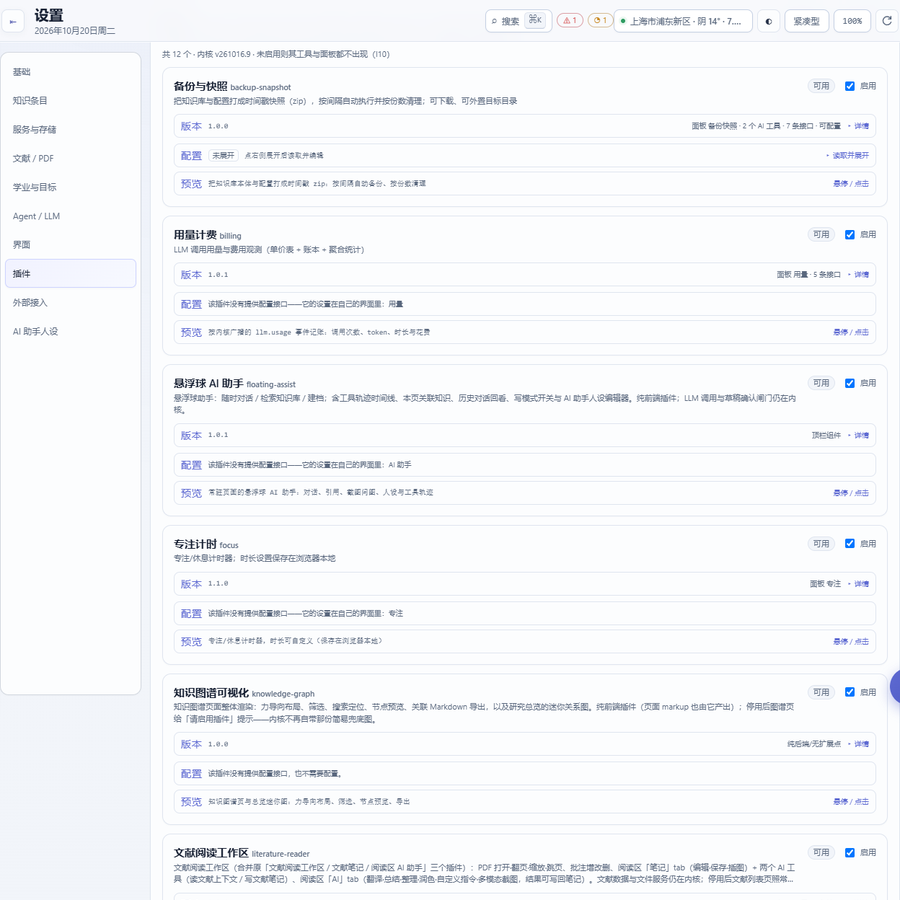

# 八、插件：使用与开发

## 1. 插件是什么

工作台由 **内核** + **插件** 组成：

- 内核负责知识库、检索、文献、Agent、待办、设置等**基础能力**；
- 插件负责具体功能页面与可选能力（日历、图谱、专注、资讯、备份、报告导出…）；
- **零插件时工作台完整可跑**：删掉 `plugins/` 下的所有目录，内核照常启动；
- 插件只能通过**公开接缝**接触内核：后端 `core_api`、前端 `window.ERW*`、公开 HTTP API。
  内核源码里不应该出现任何具体插件的 id。

当前只支持 **`inprocess`**（与内核同进程加载）插件；清单里的 `kind: "process"`（独立进程）
已有字段校验，但执行层尚未实现——写插件时按 `inprocess` 来。

## 2. 使用插件

### 2.1 在哪里管理

**设置 → 插件**：



每张卡片给出：

| 区块 | 内容 |
| --- | --- |
| 标题行 | 插件名、`id`、可用状态、**启用**开关 |
| 简介 | 这个插件解决什么问题 |
| 版本 | 插件版本、`api_version`、面板/路由/工具数量、「详情」展开权限与依赖 |
| 配置 | 插件自己的配置项（没有配置时如实说明"它在自己的界面里"） |
| 预览 | **演示预览**：摘要 + 功能点 + 截图（插件自己声明；悬停或点击展开） |

### 2.2 启用、停用、安装、更新、卸载

| 动作 | 怎么做 | 生效时机 |
| --- | --- | --- |
| **启用 / 停用** | 设置 → 插件 → 卡片右上开关 | 后端路由/工具**重启后**生效；纯前端面板刷新页面即可 |
| **安装（目录）** | 把 `plugins/<id>/` 整个目录放进插件库 | 打开设置 → 插件页或重启后被发现 |
| **安装（单文件包）** | 把 `<id>-<version>.zip` 放进 `plugins/` | 服务启动、打开插件页或 `python -m core.plugins list --install` 时自动解包到 `plugins/<id>/` |
| **更新** | 用新版本替换目录或包 | 版本不同才替换；`api_version` 不兼容会**拒绝并保留旧版** |
| **卸载** | 卡片里的卸载 | 插件移入 `Workspace/System/Trash/plugins/<id>/`；数据默认保留，是否一并删除由你勾选 |

插件库有两个来源：随包内置的库（`ASSET_ROOT/plugins/`）和你自己的数据根（`DATA_ROOT/plugins/`），
**同一个 `id` 在库里只允许一个版本**；出现重复会报冲突并列候选，由你删掉多余的那个。

### 2.3 权限与安全

- 清单里的 `permissions` 是**声明**（`ui:panel`、`storage:own`、`config:own`、`net:http`…），
  安装/启用时会展示给你，用于判断这个插件会接触什么；
- 插件**不得**直接改 `Workspace/` 下的知识库文件。要写条目必须走内核的**草稿确认闸门**：
  插件把工具声明成写工具（`spec.write: true`），Agent 调用时内核只生成草稿，你确认后才落盘；
- 「设置 → 外部接入 → **允许插件写入知识库**」关掉后，插件对知识库的写操作会被拒绝（只读工作台），
  但它仍可写自己的配置与数据目录；
- 插件与插件之间只能通过 `core_api` 或前提插件的公开接口交互，不允许 import 彼此的私有模块。

### 2.4 内置插件一览

| 插件 | id | 默认 | 作用 |
| --- | --- | --- | --- |
| 用量计费 | `billing` | 开 | LLM 调用用量与费用：单价表 + 账本 + 聚合统计 |
| 悬浮球 AI 助手 | `floating-assist` | 开 | 常驻悬浮球：对话、检索知识库、建档；自带工具轨迹与本页关联知识 |
| 专注计时 | `focus` | 开 | 专注/休息计时器（时长存浏览器本地） |
| 知识图谱可视化 | `knowledge-graph` | 开 | 图谱页整体渲染：力导向、筛选、搜索定位、节点预览、关联 Markdown 导出 |
| 文献阅读工作区 | `literature-reader` | 开 | PDF 打开/翻页/批注、阅读区「笔记」与「AI」两个 tab |
| RSS 科研资讯 | `rss` | 开 | 抓取 RSS / Atom 资讯源并按源筛选 |
| 版本管理 | `version-manager` | 开 | 同一笔记的版本族、**批量清理快照**、Agent 自动确认、逐节合并、归档与取回 |
| 天气 | `weather` | 开 | 顶栏实况天气卡片（Open-Meteo，无需 Key） |
| 日历 | `milestone-calendar` | 关 | 里程碑/待办到期视图 + 顶栏常驻角标（见[第六章](06-项目待办与里程碑.md)） |
| 指标表 | `metrics-table` | 关 | 把正文里的 `metrics` 代码块聚合成跨实验对照表，可导出 CSV/Markdown |
| 报告导出 | `report-export` | 关 | 把项目/某类条目整理成 DOCX、HTML（打印即 PDF）或 Markdown |
| 备份与快照 | `backup-snapshot` | 关 | 定时把知识库与配置打成 zip 快照，按份数清理，可下载、可外置目录 |

> 插件的完整能力与边界以各自目录下的 `README.md` 为准；`docs/PLUGIN_SPEC.md` 是权威规范。

### 2.5 插件页面出现在哪

插件会**自登记**界面位置，内核不认识具体功能：

| 位置 | 例子 |
| --- | --- |
| 侧栏导航项 | 日历（核心工作）、知识图谱、资讯、用量统计、版本…；**分组由插件自己声明** |
| 顶栏槽位 | 天气、日历角标 |
| 页面浮层槽位 | 悬浮球助手 |
| 设置页 tab | 「插件」「外部接入」等 |
| 阅读区 tab | 文献阅读工作区内的「笔记」「AI」 |

同一个插件可以只提供一个面板，也可以同时提供页面、角标与设置项。停用插件后，这些入口**一起消失**，
不会留下点不开的按钮。

### 2.6 排障

```powershell
python -m core.plugins list            # 已发现 / 已启用 / blocked / 冲突（--install 顺带解包 zip）
python -m core.plugins check <id>      # 清单校验 + 依赖与权限报告（不落盘）
python -m core.plugins verify          # 全库体检：孤儿派生库、缺失依赖、版本冲突
python tools/plugin_check.py           # 内核/插件依赖方向与隔离体检
```

| 现象 | 原因 | 处理 |
| --- | --- | --- |
| 插件卡片显示「不可用 / blocked」 | 缺少前提插件，或 `api_version`/`core_min` 不满足 | 看卡片里的原因；补装前提插件或换插件版本 |
| 两个同名插件冲突 | 目录与 zip 各一份，或两个版本 | 删掉多余的一份再刷新 |
| 开后端接口 404 | 启用后没有重启 | 重启工作台；纯前端页面只需刷新 |
| 页面样式串到内核页面 | 插件 CSS 没写在 `[data-plugin="<id>"]` 作用域里 | 改插件样式（见 §3.7） |
| 想彻底移除 | — | 停用 → 卸载（数据是否删除自己勾选） |

## 3. 开发插件

### 3.1 目录结构

```text
plugins/<id>/
├─ plugin.json          # 唯一必需文件（清单）
├─ backend.py           # 可选：后端 register(ctx)
├─ web/
│  ├─ panel.js          # 可选：前端面板（自登记）
│  ├─ panel.css         # 可选：样式，必须限定在 [data-plugin="<id>"] 内
│  └─ preview.png       # 可选：设置页演示预览截图（≤760×700，1x）
├─ migrations/          # 可选：插件自有数据的迁移脚本
└─ README.md            # 建议：说明它做什么、怎么验证、边界在哪
```

目录名**必须等于** `plugin.json` 的 `id`，否则拒载（避免"文件夹叫 A、插件自称 B"）。

### 3.2 三步做出一个插件

```powershell
# ① 从模板生成（先校验再原子落盘；默认拒绝覆盖已有目录）
python tools/new_plugin.py my-tool --name "我的工具" --desc "一句话说明它干什么"

# ② 只改三个文件：backend.py（路由/工具/配置）、web/panel.js（界面）、web/panel.css（样式）
#    不需要改内核任何文件——内核源码里不该出现你插件的 id

# ③ 验证 → 重启 → 启用
python -m core.plugins check my-tool
python tools/plugin_check.py      # 改了插件后端/清单就跑
python tools/web_check.py         # 改了插件前端就跑
```

模板 `plugins/.template/` 本身就是回归夹具：它是一份**能直接跑**的最小插件（页面 + 设置 tab +
两个路由 + 一个 Agent 工具），照它改最快。

### 3.3 `plugin.json` 关键字段

```json
{
  "id": "my-tool",
  "name": "我的工具",
  "version": "0.1.0",
  "description": "一句话说明",

  "api_version": 1,
  "core_min": "v261019",

  "kind": "inprocess",
  "distribution": "optional",
  "default_enabled": false,

  "entry": "backend.py",
  "permissions": ["ui:panel", "storage:own", "config:own"],

  "nav": [{"id": "my-tool", "label": "我的工具", "icon": "◇", "mount": "web/panel.js"}],
  "panel": {"mount": "web/panel.js", "style": "web/panel.css"},

  "routes": [{"method": "GET", "path": "hello"}],
  "mcp_tools": ["ping"],

  "preview": {
    "summary": "解决什么问题（≤40 字最好读）",
    "features": ["功能点 1", "功能点 2"],
    "where": "侧栏 → 我的工具",
    "screens": ["web/preview.png"]
  }
}
```

| 字段 | 说明 |
| --- | --- |
| `api_version` | 依赖的**内核 API 版本**；不匹配直接拒载（不是静默失效） |
| `core_min` | 最低内核版本；低于它给出明确原因 |
| `kind` | 当前只用 `inprocess` |
| `distribution` + `default_enabled` | 合起来决定"附属（bundled+true）"还是"可选（optional+false）" |
| `nav[].slot` | 声明后该面板**不进导航**，而是画进内核槽位（`topbar` / `overlay`） |
| `routes` | 路由**只写相对路径**，由内核挂到 `/api/plugins/<id>/…` |
| `mcp_tools` | 工具裸名；对外名由内核加 `p_<id>__` 前缀 |
| `preview` | 设置页卡片上的演示预览；截图放插件目录内 |

### 3.4 后端：`register(ctx)`

```python
def register(ctx):
    def hello(request):                      # request = {method, path, query, body}
        return {"ok": True, "plugin": ctx.id}

    ctx.routes.get("hello", hello)           # → GET /api/plugins/<id>/hello

    def ping(args, call_ctx=None):           # Agent 调用固定两个参数，第二个可不用但不能省
        return {"pong": True}

    ctx.mcp.tool("ping", {
        "description": "示例工具",
        "parameters": {"type": "object", "properties": {}},
    }, ping)

    ctx.log(f"{ctx.id} 已注册")
```

`ctx` 能做什么：

| 接缝 | 用途 |
| --- | --- |
| `ctx.routes.get/post/put/patch/delete(相对路径, handler)` | 自己的 HTTP 接口；禁止写 `/api/…` 裸路径 |
| `ctx.mcp.tool(裸名, spec, handler)` | 给内核 Agent 与 MCP 客户端加工具；写工具声明 `spec.write = true` 自动走草稿闸门 |
| `ctx.config_read()/config_write()` | 自己的配置 `config/plugins/<id>.json`（内核不解释内容，写入原子） |
| `ctx.storage.workspace/system/cache_db` | 自己的数据落点：`Workspace/Plugins/<id>/`、`System/Plugins/<id>/`、`System/Cache/<id>.sqlite` |
| `ctx.events.on("llm.usage", cb)` | 订阅内核广播（返回退订函数） |
| `ctx.jobs.add(name, cb, every_minutes=…)` | 后台任务由内核调度；**不要自己起线程** |
| `ctx.raw(bytes, content_type=…, filename=…)` | 非 JSON 原样响应（导出文件、CSV、图表） |
| `ctx.log(msg)` | 带插件前缀的日志 |

读知识库用 `core_api` 的只读窗口：`entry / entries / projects / project_names / todos /
dashboard / kind_labels / kernel_version`；写条目用 `entry_update(...)`（字段白名单与校验在内核）。
出网用 `core_api.http_get(...)`（带代理兜底）。

### 3.5 前端：自登记 + 接缝

```js
window.ERWPanels.register({
  id: 'my-tool',
  group: 'core',            // 侧栏分组：core / research / resources / system
  before: 'agent',          // 插到哪个路由之前
  label: '我的工具',
  icon: '◇',
  eyebrow: 'PLUGIN',
  title: '我的工具',
  render: function (main) { /* 只画 main 内部 */ },
});
```

| 接缝 | 用途 |
| --- | --- |
| `window.ERWPanels.register({...})` | 侧栏导航页 / 设置页 tab / 槽位面板 |
| `window.erwFetch(url, init)` | 出网与调内核 API；**不得替换 `window.fetch`** |
| `window.ERWToast(msg, error?)` | 内核提示条（做空值保护） |
| `window.ERWContract` | 七类 kind、标记、关系的中文契约（别再抄一份标签表） |
| `window.ERWMarkdown.renderInto(el, md)` | 与条目编辑器同一套 Markdown 渲染 |
| `window.ERWDom.onChildList(cb, {root})` | 文档级 DOM 变更观察的唯一入口 |
| `window.erwVendor.load('mathjax' \| 'mermaid')` | 重型库按需加载 |
| `data-plugin="<id>"` | 内核给挂载容器打的属性；**插件 CSS 必须限定在它下面** |

### 3.6 一个最小页面（可直接照抄）

```js
(function () {
  'use strict';
  var ID = 'my-tool';
  function api(path) { return window.erwFetch('/api/plugins/' + ID + '/' + path).then(r => r.json()); }

  window.ERWPanels.register({
    id: ID, group: 'system', before: 'settings',
    label: '我的工具', icon: '◇', title: '我的工具',
    render: function (main) {
      main.innerHTML = '<section class="card card-pad"><h3>我的工具</h3>'
        + '<pre id="my-out">加载中…</pre></section>';
      api('hello').then(function (data) {
        var out = document.getElementById('my-out');
        if (out) out.textContent = JSON.stringify(data, null, 2);
      }).catch(function (e) {
        if (window.ERWToast) window.ERWToast('读取失败：' + e.message, true);
      });
    },
  });
})();
```

### 3.7 红线（违反了要么拒载、要么污染内核）

1. **不得修改内核**：不改 `app/`、`core/`、`web/`；不覆盖 `window.fetch`；不往 `document.body` 塞 DOM；
2. **后端只允许 `from core_api import …`**：不得 import `core.*` 私有模块，也不得 import 别的插件；
3. **不得直写 `Workspace/`** 的知识库文件；写条目走 `core_api.entry_update` + 写工具草稿闸门；
4. **CSS 必须限定作用域**：`[data-plugin="<id>"] .xxx { … }`，否则样式会漏到内核页面；
5. **不要自己起线程**：后台任务用 `ctx.jobs.add(...)`；
6. **工具 handler 固定两个参数**：`handler(args, call_ctx=None)`，少写一个会在 Agent 调用时报错；
7. **路由只写相对路径**：写成 `/api/xxx` 会被拒；工具名不要自带 `p_` 前缀或 `__`。

### 3.8 验证、打包与安装

```powershell
python tools/plugin_check.py          # 依赖方向单向、内核可脱离插件、零插件合法
python tools/web_check.py             # 前端语法、装配清单、window.ERW* 接缝完整性
python tools/ui_smoke.py              # 真浏览器逐个路由走查（含插件页）
python tests/plugins/test_calendar.py # 单个插件的端到端夹具示例
```

**打包成单文件**：把插件目录压成 `plugins/<id>-<version>.zip`，`plugin.json` 必须在压缩包根目录
（不能多套一层文件夹，也不能把多个插件塞进一个包）。安装时内核会：

1. 解包到 `plugins/.unpack-<id>-<version>/` → 全部校验通过后**原子改名**为 `plugins/<id>/`；
2. 已存在同 id 目录且版本不同 → 旧目录整体移入回收站，再放新版（**不逐文件合并**）；
3. 你自己手放的目录不会被同名 zip 覆盖（解包目录带 `.erw-unpacked` 标记）。

### 3.9 常见错误

| 报错/现象 | 原因 | 处理 |
| --- | --- | --- |
| 拒载：目录名与 id 不一致 | 文件夹叫 A、`plugin.json` 里 id 是 B | 改成一致 |
| 拒载：`api_version` 不匹配 | 插件依赖的内核 API 版本不同 | 升级内核或换插件版本 |
| `blocked`：缺少前提插件 | `requires.plugins` 未满足 | 安装并启用前提插件 |
| 页面空白、路由 404 | 后端没重启 / 路由写成了绝对路径 | 重启；改成相对路径 |
| 工具调用 TypeError | handler 少写了 `call_ctx` 参数 | 改成 `handler(args, call_ctx=None)` |
| 样式串页 | CSS 没加 `[data-plugin="<id>"]` 前缀 | 收进作用域 |
| `plugin.json` 解析失败 | 文件带 BOM 或不是 UTF-8 | 另存为 UTF-8 无 BOM |
| 启用后被自动停用 | 注册时连续抛错（hook 失败保护） | 看 `workbench.log` 里带插件前缀的日志 |

## 4. 兼容性与边界

- `api_version` 只在**破坏性变更**时提升；新增接缝、新增字段不动它；
- `core_min` 是插件侧的下限：内核版本高于它就一直可用；
- 现有接缝覆盖不到的三种情况：**接管一种全新形态**（需要内核加一个接缝）、
  `ctx.search.addSection`（检索框分区，未实现）、`process` 执行层（未实现）；
- 判定标准：**内核在无该插件时是否报错/白屏**。某块可选 UI 消失不算问题；
  把可选 UI 搬回内核、让内核依赖具体功能，才是方向错误。

> 更细的契约（能力矩阵、打包规则、兼容承诺、回归清单）见仓库根目录
> `docs/PLUGIN_SPEC.md`；插件自己的说明见 `plugins/<id>/README.md`。
